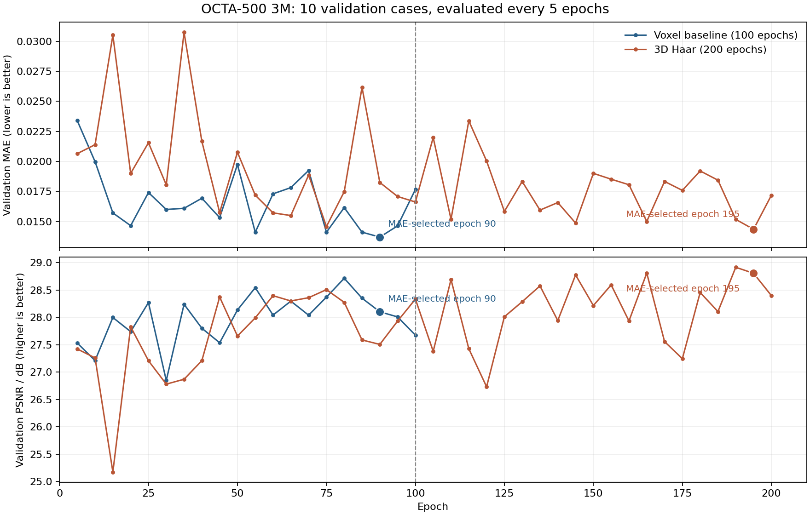

# 3DFM-OCTA

**统一查看先前所有实验：[实验总览与比较表](docs/experiments/README.md)**

现已归档完整训练、小样本消融、原生 FlowOCT 对照、3D FlowOCT 完整模块、起点监督、长预算续训和机制诊断。
每个系列都可查看代码、配置、数字记录、曲线和全部已保存结果图；[完整归档目录](research_archive/) 保留历史与阶段快照。

用于 OCT → OCTA 的 **3D Flow Matching 基线**与 **3D Flow Matching + 三维 Haar 小波**代码。
两种方法共享数据加载、3D U-Net、训练与全体积推理实现，使用不同训练入口。

| 方法 | 训练入口 | 表示 | 详细说明 |
| --- | --- | --- | --- |
| 3DFM 基线 | `python -m fm3d.train` | 原始三维体素 | [基线说明](fm3d/README.md) |
| 3DFM + 3D Haar 小波 | `python -m fm3d.train_wavelet` | 三维 Haar 八子带 | [小波说明](fm3d/WAVELET.md) |

本仓库发布源代码、测试、依赖、操作说明，以及用于审阅的实验记录、结果图与派生指标。
模型权重、原始医学体积、患者名单和完整运行输出由使用者在本地管理。
源代码快照整理于 2026-10-22。既有说明中的服务器路径、压缩包名和结果目录属于历史运行示例，运行时替换为自己的路径。
这是独立研究实现，方法源于 FlowOCT 的配对直线路径思路；FlowOCT 官方代码见 [cnu-medilab/FlowOCT](https://github.com/cnu-medilab/FlowOCT)。

## 给审阅者的材料

请先阅读 **[结果、配置与五例对比图](docs/review/README.md)**，再结合
[代码审阅指南](docs/review/CODE_REVIEW_GUIDE.md) 查看实现。
材料包含 50 例成对测试指标、两组训练与验证曲线、五例固定窗/增强窗对比图，以及实际配置。
可以用 [复核脚本](docs/review/reproduce_summary.py) 从随附指标表重算均值、成对 bootstrap 区间和曲线，无需数据与权重。

**这批历史结果比较的是：基线训练 100 轮、选择第 90 轮；小波训练 200 轮、选择第 195 轮。**
它与本页下方采用 200/200 轮的训练命令示例有区别，尚不能单独作为相同预算下的小波消融结论。

| 50 例完整体积测试 | 3DFM 基线 | 3DFM + 3D Haar |
| --- | ---: | ---: |
| MAE ↓ | 0.013878 | 0.014594 |
| PSNR ↑ | 28.322 dB | 28.898 dB |

这一快照中小波的 MAE 更高、PSNR 更高；投影指标也存在权衡，详见评审材料。



## 安装

建议使用 Python 3.10。根据运行机器安装兼容的 PyTorch 2.5.1 后，在仓库根目录执行：

```bash
python -m pip install -r requirements.txt
```

需要 SSIM、LPIPS、FID 等扩展评价与图表时再安装：

```bash
python -m pip install -r requirements-eval.txt
```

更多环境说明见 [Ubuntu 运行说明](fm3d/UBUNTU.md)。

## 数据

数据与病例划分由使用者自行准备。每例 NPZ 包含同尺寸的 `oct`、`octa` 三维数组；CSV 使用
`case_id,patient_id,path,split`，其中 `split` 为 `train`、`validation` 或 `test`。
CSV 的 `path` 相对 CSV 所在目录。必须根据真实数据确认轴序、患者对应关系和灰度范围。

代码校验 3M 的 140/10/50 或 6M 的 180/20/100 配对体划分。下面假设已核实
`ZYX` 轴序、原始 8-bit 灰度，以及位于 `data/OCTA500_common_v1/` 的病例清单。
数据准备步骤见 [基线说明](fm3d/README.md)；`tools/prepare_common_octa500.py` 为原始 BMP 批量准备工具。

## 训练两种方法

所有命令在包含 `fm3d/` 的仓库根目录执行。以下两组均设为 200 轮以对齐训练预算；
基线入口原有默认值为 100 轮，小波入口默认值为 200 轮。

```bash
# 3DFM 基线：体素空间
python -m fm3d.train \
  --manifest data/OCTA500_common_v1/split_3M_z256.csv --fov 3M \
  --axis-order ZYX --intensity-scale 255 --depth 256 \
  --patch 256 64 64 --base-channels 16 --condition \
  --batch-size 1 --epochs 200 --steps-per-epoch 200 \
  --lr 2e-4 --val-every 5 --ode-steps 8 --overlap 0.5 \
  --seed 2026 --workers 0 --device cuda --amp --save-every 5 \
  --output runs/fm3d_3M_200

# 3DFM + 三维 Haar 小波：保持相同的原始体块和训练预算
bash fm3d/scripts/train_wavelet_200.sh \
  data/OCTA500_common_v1/split_3M_z256.csv \
  3M runs/fm3d_haar3d_3M_200
```

Windows PowerShell 可使用 `python -m fm3d.train_wavelet` 并传入相同参数；`--patch` 始终填写体素空间尺寸。
续训时保持原运行路径与关键配置，并在原命令末尾增加 `--resume`。
三维小波保留全部八个子带，使用可微正交变换；无需额外小波库。

另保留了曾用于基线从第 100 轮续训至第 200 轮、每 10 轮保存区间最佳权重的
[独立训练脚本快照](snapshots/baseline_resume_200/README.md)。该快照与共享入口分开保存。

## 评价和可视化

统一评价入口读取本地 checkpoint 中的表示与数据协议，支持上述两种方法：

```bash
python -m fm3d.evaluate \
  --checkpoint runs/fm3d_3M_200/best.pt \
  --split test --device cuda --output runs/fm3d_3M_test

python -m fm3d.visualize \
  --input runs/fm3d_3M_test --output runs/fm3d_3M_test_report
```

小波模型只需换用对应运行目录的 checkpoint。生成的体积与图片默认保留在本地，由 `.gitignore` 排除；
仓库只对 `docs/review/` 中明确列出的评审图表设置例外。
扩展指标见 [评价说明](fm3d/EVALUATION.md)。
共享代码还保留了独立的 [Z 投影监督扩展](fm3d/PROJECTION.md)；上述两种基础方案的投影损失权重均为 0。

## 验证

核心训练、断点恢复、数据协议与小波测试只依赖基础环境；PyWavelets 数值对照为可选测试：

```bash
python -m unittest fm3d.test_core fm3d.test_wavelet -v
```

安装扩展评价依赖后可运行全部现有测试：

```bash
python -m unittest discover -s fm3d -t . -p 'test_*.py' -v
```

## 主要文件

```text
fm3d/
  model.py                 时间条件 3D U-Net 与 FM 损失
  wavelets.py              三维 Haar DWT / IDWT
  data.py                  数据协议、BMP 打包、划分与配对体块
  train.py                 共享训练与体素基线入口
  train_wavelet.py         三维小波训练入口
  inference.py             全体积滑窗 ODE 推理
  evaluate.py              按 checkpoint 协议评价
  scripts/                 服务器启动脚本
  test_*.py                现有验证测试
tools/                     数据准备与评价辅助工具
docs/review/               冻结结果、五例对比图、指标表与审阅指南
docs/experiments/          所有实验总览、按系列比较表与训练记录总览
research_archive/          原实验代码、配置、结果、图像与服务器轻量快照
snapshots/baseline_resume_200/
                           基线 200 轮续训训练脚本快照
```
