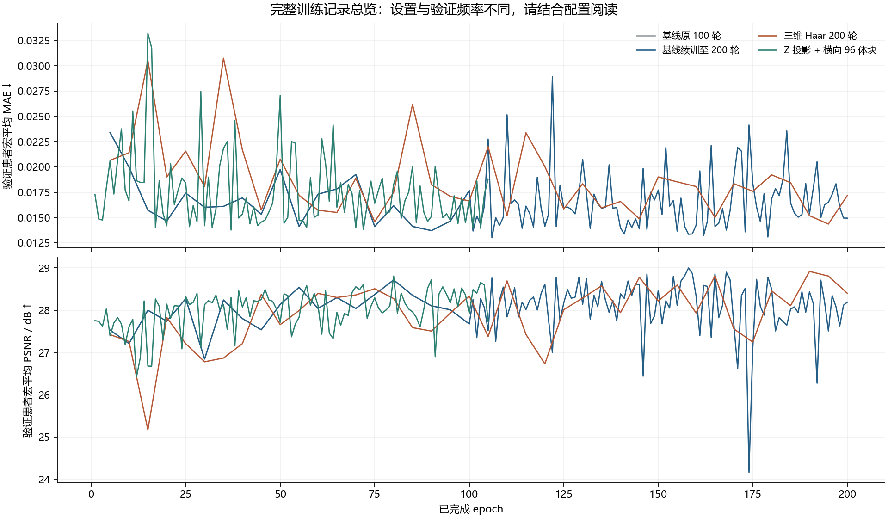

# 实验统一观察入口

归档时间：2026-10-22 12:56:30（北京时间）。
本页将先前分散在本地和服务器的实验放在同一仓库中，保留成功、失败、旧分支和阶段性尝试。
原始医学体积、权重、原始标注、患者身份清单、压缩包和环境缓存未上传。

目前汇总 **49 条终点/求解设置比较**，另有完整训练记录、机制探针和运行验证。
这里的一条比较不等于一个独立训练：FlowOCT 的 native3/shared8 可能来自同一权重，长预算组也可能是续训。

不同体块、病例集合、训练预算、推理步骤和评价区域之间不做统一排名。请先在相同实验系列内比较。

## 实验目录

| 系列 | 训练预算 | 范围与状态 | 查看 |
| --- | --- | --- | --- |
| 五组损失消融 + 原生 FlowOCT + 1600 次诊断 | 单病例 400 / 四病例 800；诊断对照 1600 | 固定 256×64×64，验证 4 位患者；原五组、FlowOCT 两阶段及诊断均有最终记录 | [报告](<../../research_archive/experiments/ablation_validation_20261021/reports/FLOWOCT_DIAGNOSIS.md>) · [代码/记录](<../../research_archive/experiments/ablation_validation_20261021>) · [全部图像](<../../research_archive/experiments/ablation_validation_20261021/FIGURES.md>) |
| 256³ 视野对照 + FlowOCT 去模块 | 每组 400 次；单病例 | 固定中央 256³，验证 4 位患者；原六组 + Haar-only 已完成；FM-only 见快照状态 | [报告](<../../research_archive/experiments/ablation_validation_256cube_20261021/reports/CONCLUSIONS.md>) · [代码/记录](<../../research_archive/experiments/ablation_validation_256cube_20261021>) · [全部图像](<../../research_archive/experiments/ablation_validation_256cube_20261021/FIGURES.md>) |
| 3D FlowOCT 完整模块及 RDCA / 投影 / 结构消融 | 12 个运行，共 8000 次成功更新 | 单病例 400 / 四病例 800；固定 256×64×64；12 个运行已完成 | [报告](<../../research_archive/experiments/flowoct3d_full_20261022/reports/实验报告.md>) · [代码/记录](<../../research_archive/experiments/flowoct3d_full_20261022>) · [全部图像](<../../research_archive/experiments/flowoct3d_full_20261022/FIGURES.md>) |
| 均匀 FM / 纯起点 / 半数起点匹配对照 | 三组各 2400 次 | 同一训练体块；主推理为 8 / 1 / 8 步；complete | [报告](<../../research_archive/experiments/fm_start_control_20261022/验证报告.md>) · [代码/记录](<../../research_archive/experiments/fm_start_control_20261022>) · [全部图像](<../../research_archive/experiments/fm_start_control_20261022/FIGURES.md>) |
| 起点三组的长预算续训 | 三组各达到 4800，再达到 7200 次 | 恢复优化器与 AMP；同一训练体块；三组 4800 / 7200 均完成 | [报告](<../../research_archive/experiments/fm_start_long_20261022/SERVER_RUN.md>) · [代码/记录](<../../research_archive/experiments/fm_start_long_20261022>) · [全部图像](<../../research_archive/experiments/fm_start_long_20261022/FIGURES.md>) |
| 监督能力 / 速度场 / 公式与积分器诊断 | 两种直接监督各 2400 次；冻结 FM 权重探针 | 训练与验证固定块；不是完整方法排名；诊断与能力对照已完成 | [报告](<../../research_archive/experiments/three_diagnostics_20261021/诊断报告.md>) · [代码/记录](<../../research_archive/experiments/three_diagnostics_20261021>) · [全部图像](<../../research_archive/experiments/three_diagnostics_20261021/FIGURES.md>) |
| 公开 FlowOCT 到三维模块的逐步对照 | 按归档时状态，仍在进行 | 保存已有配置、预检、阶段指标；不冒充最终结果；running | [报告](<../../research_archive/experiments/flowoct3d_progressive_20261022/README.md>) · [代码/记录](<../../research_archive/experiments/flowoct3d_progressive_20261022>) · [全部图像](<../../research_archive/experiments/flowoct3d_progressive_20261022/FIGURES.md>) |

另有 [FlowOCT 原流程复现与显存/恢复验证](<../../research_archive/flowoct_reproduction/VERIFICATION.md>)、[原基线故障诊断](<../../research_archive/artifacts/fm3d_failure_diagnosis_20261021>)、[预处理比较审计](<../../research_archive/artifacts/preprocessing_audit_20261019>)、[早期最小实验代码](<../../research_archive/learning>)。

## 完整数据训练记录

| 实验 | 记录进度 | 验证 MAE 选中轮次 | 验证 MAE | 同轮验证 PSNR | 记录 |
| --- | --- | --- | --- | --- | --- |
| 基线原 100 轮 | 100/100 | 90 | 0.013700 | 28.102 | [history](<../../research_archive/analysis/haar3d_200_2026-10-21/baseline_history.jsonl>) |
| 基线续训至 200 轮 | 200/200 | 106 | 0.012990 | 28.760 | [history](<../../research_archive/server_runs/fm3d_ubuntu/runs/fm3d_3M_run01/history.jsonl>) |
| 三维 Haar 200 轮 | 200/200 | 195 | 0.014348 | 28.807 | [history](<../../research_archive/server_runs/fm3d_wavelet_200/runs/fm3d_haar3d_3M_200/history.jsonl>) |
| Z 投影 + 横向 96 体块 | 105/200 | 37 | 0.013751 | 28.302 | [history](<../../research_archive/server_runs/fm3d_zproj_96_200/runs/fm3d_zproj_3M_96_200/history.jsonl>) |

基线已经完成 200 轮，验证最优为第 106 轮；此前 50 例测试图与旧评审材料依然对应基线第 90 轮。这里没有重新运行基线第 106 轮测试，也没有把它与小波测试结果混成新的同预算测试表。

Z 投影 96 体块组仍按归档时已完成轮次展示，目标 200 轮不代表已经完成。基线前后段验证频率也发生变化。

[旧 50 例测试比较与固定窗样例](<../review/README.md>) · [完整 50 例图集源文件](<../../research_archive/analysis/haar3d_200_2026-10-21/visual_comparison_50cases/index.html>) · [50 例全部图片](<../../research_archive/analysis/haar3d_200_2026-10-21/visual_comparison_50cases>)

## 小样本与终点指标

下表 PCC / SSIM 均注明投影范围。前四个固定体块系列使用 ILM–OPL 最大投影，验证值按患者先汇总。
纯起点直接拟合组以单步作为主要用法；其多步结果仅保留在原报告供诊断。

[下载全部比较 CSV](<run_comparisons.csv>) · [结构化比较 JSON](<run_comparisons.json>)

### 五组损失消融 + 原生 FlowOCT + 1600 次诊断

| 阶段 | 方法 | 成功更新 | 推理 | 训练 PCC | 训练 SSIM | 验证 PCC | 验证 SSIM | 原记录 |
| --- | --- | --- | --- | --- | --- | --- | --- | --- |
| few_case | 01_fm3d | 800 | Euler8 | 0.2714 | 0.2141 | 0.2970 | 0.2040 | [JSON](<../../research_archive/experiments/ablation_validation_20261021/01_fm3d/few_case/final_metrics.json>) |
| few_case | 02_fm3d_wavelet | 800 | Euler8 | 0.3258 | 0.2314 | 0.3252 | 0.1901 | [JSON](<../../research_archive/experiments/ablation_validation_20261021/02_fm3d_wavelet/few_case/final_metrics.json>) |
| few_case | 03_fm3d_zproj | 800 | Euler8 | 0.2239 | 0.1986 | 0.2723 | 0.2061 | [JSON](<../../research_archive/experiments/ablation_validation_20261021/03_fm3d_zproj/few_case/final_metrics.json>) |
| few_case | 04_fm3d_wavelet_zproj | 800 | Euler8 | 0.3240 | 0.2374 | 0.3258 | 0.1999 | [JSON](<../../research_archive/experiments/ablation_validation_20261021/04_fm3d_wavelet_zproj/few_case/final_metrics.json>) |
| few_case | 05_fm3d_wavelet_zproj_reconstruction | 800 | Euler8 | 0.2967 | 0.2468 | 0.2779 | 0.1888 | [JSON](<../../research_archive/experiments/ablation_validation_20261021/05_fm3d_wavelet_zproj_reconstruction/few_case/final_metrics.json>) |
| few_case | 06_flowoct | 800 | native3 | 0.4107 | 0.3111 | 0.3904 | 0.2452 | [JSON](<../../research_archive/experiments/ablation_validation_20261021/06_flowoct/few_case/final_native3.json>) |
| few_case | 06_flowoct | 800 | shared8 | 0.4079 | 0.3103 | 0.3853 | 0.2461 | [JSON](<../../research_archive/experiments/ablation_validation_20261021/06_flowoct/few_case/final_shared8.json>) |
| flowoct_1600 | diagnostics | 1600 | Euler8 | 0.4301 | 0.3476 | 0.3072 | 0.1913 | [JSON](<../../research_archive/experiments/ablation_validation_20261021/diagnostics/flowoct_1600/final_metrics.json>) |
| flowoct_1600 | diagnostics | 1600 | native3 | 0.4370 | 0.3346 | 0.3055 | 0.1966 | [JSON](<../../research_archive/experiments/ablation_validation_20261021/diagnostics/flowoct_1600/final_native3.json>) |
| one_case | 01_fm3d | 400 | Euler8 | 0.2512 | 0.1568 | 0.3215 | 0.2016 | [JSON](<../../research_archive/experiments/ablation_validation_20261021/01_fm3d/one_case/final_metrics.json>) |
| one_case | 02_fm3d_wavelet | 400 | Euler8 | 0.2909 | 0.1785 | 0.3333 | 0.1861 | [JSON](<../../research_archive/experiments/ablation_validation_20261021/02_fm3d_wavelet/one_case/final_metrics.json>) |
| one_case | 03_fm3d_zproj | 400 | Euler8 | 0.2683 | 0.1493 | 0.3303 | 0.1958 | [JSON](<../../research_archive/experiments/ablation_validation_20261021/03_fm3d_zproj/one_case/final_metrics.json>) |
| one_case | 04_fm3d_wavelet_zproj | 400 | Euler8 | 0.2649 | 0.1675 | 0.3205 | 0.1928 | [JSON](<../../research_archive/experiments/ablation_validation_20261021/04_fm3d_wavelet_zproj/one_case/final_metrics.json>) |
| one_case | 05_fm3d_wavelet_zproj_reconstruction | 400 | Euler8 | 0.2886 | 0.1648 | 0.3170 | 0.1861 | [JSON](<../../research_archive/experiments/ablation_validation_20261021/05_fm3d_wavelet_zproj_reconstruction/one_case/final_metrics.json>) |
| one_case | 06_flowoct | 400 | native3 | 0.4782 | 0.3666 | 0.3512 | 0.2216 | [JSON](<../../research_archive/experiments/ablation_validation_20261021/06_flowoct/one_case/final_native3.json>) |
| one_case | 06_flowoct | 400 | shared8 | 0.4747 | 0.3778 | 0.3588 | 0.2206 | [JSON](<../../research_archive/experiments/ablation_validation_20261021/06_flowoct/one_case/final_shared8.json>) |
| start_only_mse | diagnostics | 1600 | Euler8 | 0.9208 | 0.8881 | 0.2855 | 0.1928 | [JSON](<../../research_archive/experiments/ablation_validation_20261021/diagnostics/start_only_mse/final_metrics.json>) |
| time_scale_1 | diagnostics | 400 | Euler8 | 0.2661 | 0.1577 | 0.3150 | 0.2097 | [JSON](<../../research_archive/experiments/ablation_validation_20261021/diagnostics/time_scale_1/final_metrics.json>) |
| uniform_fm_1600 | diagnostics | 1600 | Euler8 | 0.3290 | 0.1634 | 0.3300 | 0.2175 | [JSON](<../../research_archive/experiments/ablation_validation_20261021/diagnostics/uniform_fm_1600/final_metrics.json>) |

### 256³ 视野对照 + FlowOCT 去模块

| 阶段 | 方法 | 成功更新 | 推理 | 训练 PCC | 训练 SSIM | 验证 PCC | 验证 SSIM | 原记录 |
| --- | --- | --- | --- | --- | --- | --- | --- | --- |
| one_case | 01_fm3d | 400 | Euler8 | 0.3732 | 0.1494 | 0.3455 | 0.1593 | [JSON](<../../research_archive/experiments/ablation_validation_256cube_20261021/01_fm3d/one_case/final_metrics.json>) |
| one_case | 02_fm3d_wavelet | 400 | Euler8 | 0.3937 | 0.1623 | 0.3821 | 0.1827 | [JSON](<../../research_archive/experiments/ablation_validation_256cube_20261021/02_fm3d_wavelet/one_case/final_metrics.json>) |
| one_case | 03_fm3d_zproj | 400 | Euler8 | 0.3482 | 0.1498 | 0.3111 | 0.1599 | [JSON](<../../research_archive/experiments/ablation_validation_256cube_20261021/03_fm3d_zproj/one_case/final_metrics.json>) |
| one_case | 04_fm3d_wavelet_zproj | 400 | Euler8 | 0.3885 | 0.1540 | 0.3423 | 0.1639 | [JSON](<../../research_archive/experiments/ablation_validation_256cube_20261021/04_fm3d_wavelet_zproj/one_case/final_metrics.json>) |
| one_case | 05_fm3d_wavelet_zproj_reconstruction | 400 | Euler8 | 0.3924 | 0.1453 | 0.3212 | 0.1481 | [JSON](<../../research_archive/experiments/ablation_validation_256cube_20261021/05_fm3d_wavelet_zproj_reconstruction/one_case/final_metrics.json>) |
| one_case | 06_flowoct | 400 | Euler8 | 0.4694 | 0.2528 | 0.4347 | 0.2574 | [JSON](<../../research_archive/experiments/ablation_validation_256cube_20261021/06_flowoct/one_case/final_metrics.json>) |
| one_case | 06_flowoct |  | native3 | 0.4679 | 0.2393 | 0.4361 | 0.2497 | [JSON](<../../research_archive/experiments/ablation_validation_256cube_20261021/06_flowoct/one_case/final_native3.json>) |
| one_case | 08_flowoct_wavelet_only | 400 | native3 | 0.4891 | 0.2465 | 0.4489 | 0.2722 | [JSON](<../../research_archive/experiments/ablation_validation_256cube_20261021/08_flowoct_wavelet_only/one_case/final_native3.json>) |
| one_case | 08_flowoct_wavelet_only | 400 | shared8 | 0.4869 | 0.2556 | 0.4430 | 0.2703 | [JSON](<../../research_archive/experiments/ablation_validation_256cube_20261021/08_flowoct_wavelet_only/one_case/final_metrics.json>) |

### 3D FlowOCT 完整模块及 RDCA / 投影 / 结构消融

| 阶段 | 方法 | 成功更新 | 推理 | 训练 PCC | 训练 SSIM | 验证 PCC | 验证 SSIM | 原记录 |
| --- | --- | --- | --- | --- | --- | --- | --- | --- |
| few_case | 01_voxel_fm | 800 | Euler8 | 0.2563 | 0.2007 | 0.2854 | 0.1968 | [JSON](<../../research_archive/experiments/flowoct3d_full_20261022/01_voxel_fm/few_case/final_metrics.json>) |
| few_case | 02_haar_fm | 800 | Euler8 | 0.3259 | 0.2317 | 0.3256 | 0.1904 | [JSON](<../../research_archive/experiments/flowoct3d_full_20261022/02_haar_fm/few_case/final_metrics.json>) |
| few_case | 03_full | 800 | Euler8 | 0.2544 | 0.2328 | 0.2632 | 0.1929 | [JSON](<../../research_archive/experiments/flowoct3d_full_20261022/03_full/few_case/final_metrics.json>) |
| few_case | 04_no_rdca | 800 | Euler8 | 0.2059 | 0.2112 | 0.2135 | 0.1693 | [JSON](<../../research_archive/experiments/flowoct3d_full_20261022/04_no_rdca/few_case/final_metrics.json>) |
| few_case | 05_no_projection | 800 | Euler8 | 0.1925 | 0.1972 | 0.1943 | 0.1541 | [JSON](<../../research_archive/experiments/flowoct3d_full_20261022/05_no_projection/few_case/final_metrics.json>) |
| few_case | 06_no_structure | 800 | Euler8 | 0.3399 | 0.2352 | 0.3540 | 0.1924 | [JSON](<../../research_archive/experiments/flowoct3d_full_20261022/06_no_structure/few_case/final_metrics.json>) |
| few_case | 07_no_reconstruction | 800 | Euler8 | 0.2430 | 0.2257 | 0.2404 | 0.1806 | [JSON](<../../research_archive/experiments/flowoct3d_full_20261022/07_no_reconstruction/few_case/final_metrics.json>) |
| few_case | 08_full_half_start | 800 | Euler8 | 0.3638 | 0.2615 | 0.3254 | 0.2052 | [JSON](<../../research_archive/experiments/flowoct3d_full_20261022/08_full_half_start/few_case/final_metrics.json>) |
| one_case | 01_voxel_fm | 400 | Euler8 | 0.2546 | 0.1599 | 0.3276 | 0.2014 | [JSON](<../../research_archive/experiments/flowoct3d_full_20261022/01_voxel_fm/one_case/final_metrics.json>) |
| one_case | 02_haar_fm | 400 | Euler8 | 0.2912 | 0.1787 | 0.3339 | 0.1861 | [JSON](<../../research_archive/experiments/flowoct3d_full_20261022/02_haar_fm/one_case/final_metrics.json>) |
| one_case | 03_full | 400 | Euler8 | 0.3464 | 0.2122 | 0.3203 | 0.1941 | [JSON](<../../research_archive/experiments/flowoct3d_full_20261022/03_full/one_case/final_metrics.json>) |
| one_case | 08_full_half_start | 400 | Euler8 | 0.3482 | 0.2040 | 0.3369 | 0.1936 | [JSON](<../../research_archive/experiments/flowoct3d_full_20261022/08_full_half_start/one_case/final_metrics.json>) |

### 均匀 FM / 纯起点 / 半数起点匹配对照

| 阶段 | 方法 | 成功更新 | 推理 | 训练 PCC | 训练 SSIM | 验证 PCC | 验证 SSIM | 原记录 |
| --- | --- | --- | --- | --- | --- | --- | --- | --- |
| updates_2400 | direct_t0 | 2400 | single_step | 0.9655 | 0.9537 | 0.2411 | 0.1594 | [JSON](<../../research_archive/experiments/fm_start_control_20261022/direct_t0/result.json>) |
| updates_2400 | fm_half_start | 2400 | Euler8 | 0.8785 | 0.8369 | 0.3285 | 0.2401 | [JSON](<../../research_archive/experiments/fm_start_control_20261022/fm_half_start/result.json>) |
| updates_2400 | fm_uniform | 2400 | Euler8 | 0.3167 | 0.1454 | 0.2966 | 0.1947 | [JSON](<../../research_archive/experiments/fm_start_control_20261022/fm_uniform/result.json>) |

### 起点三组的长预算续训

| 阶段 | 方法 | 成功更新 | 推理 | 训练 PCC | 训练 SSIM | 验证 PCC | 验证 SSIM | 原记录 |
| --- | --- | --- | --- | --- | --- | --- | --- | --- |
| updates_4800 | direct_t0 | 4800 | single_step | 0.9935 | 0.9923 | 0.2341 | 0.1489 | [JSON](<../../research_archive/experiments/fm_start_long_20261022/stage_4800/direct_t0/result.json>) |
| updates_4800 | fm_half_start | 4800 | Euler8 | 0.9565 | 0.9478 | 0.2853 | 0.2071 | [JSON](<../../research_archive/experiments/fm_start_long_20261022/stage_4800/fm_half_start/result.json>) |
| updates_4800 | fm_uniform | 4800 | Euler8 | 0.3238 | 0.1568 | 0.3066 | 0.2061 | [JSON](<../../research_archive/experiments/fm_start_long_20261022/stage_4800/fm_uniform/result.json>) |
| updates_7200 | direct_t0 | 7200 | single_step | 0.9957 | 0.9948 | 0.2381 | 0.1435 | [JSON](<../../research_archive/experiments/fm_start_long_20261022/stage_7200/direct_t0/result.json>) |
| updates_7200 | fm_half_start | 7200 | Euler8 | 0.9864 | 0.9843 | 0.2814 | 0.2037 | [JSON](<../../research_archive/experiments/fm_start_long_20261022/stage_7200/fm_half_start/result.json>) |
| updates_7200 | fm_uniform | 7200 | Euler8 | 0.2554 | 0.1342 | 0.2645 | 0.1886 | [JSON](<../../research_archive/experiments/fm_start_long_20261022/stage_7200/fm_uniform/result.json>) |

### 监督能力 / 速度场 / 公式与积分器诊断

归档时没有可纳入的最终指标；请查看该组状态、预检和阶段记录。

### 公开 FlowOCT 到三维模块的逐步对照

归档时没有可纳入的最终指标；请查看该组状态、预检和阶段记录。

## 先看这些图

下面选用已有汇总图作为入口；每组全部逐例结果在上方“全部图像”中。

### 3D FM / FlowOCT / 直接拟合：同为 1600 次

### 256³ 训练病例的方法对照

### 3D FlowOCT 完整模块消融

### 均匀 FM / 直接起点 / 半数起点

### 公式、速度与能力诊断

## 归档说明

- 历史报告保留当时的判断，可能随后被新实验补充或修正；应同时阅读对应日期、预算与状态。
- 某些原报告链接指向未上传的权重、NPZ 或服务器文件。这些引用用于追溯，不代表仓库包含原始大文件。
- 历史源码尽量按字节保留，包含的机器路径需要自行配置；文档和数值记录中的私人机器路径改为示例。
- 公开数据集编号用于配对科学结果，不是患者真实姓名或私人身份映射。
- 归档是本次整理时的快照，不会自动随正在运行的实验更新。

[逐文件来源与 SHA-256](<../../research_archive/ARCHIVE_MANIFEST.json>) · [实验目录 JSON](<catalog.json>) · [FlowOCT MIT 许可](<../../research_archive/THIRD_PARTY_FLOWOCT_LICENSE>)
