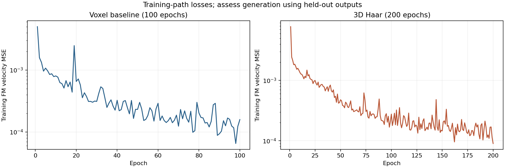
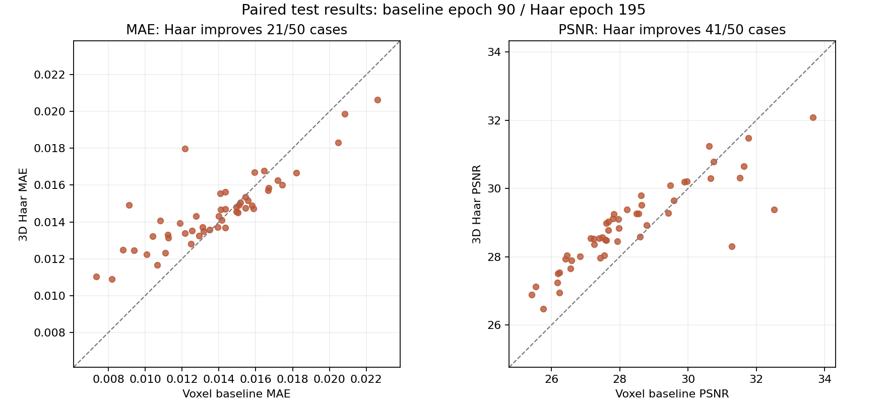
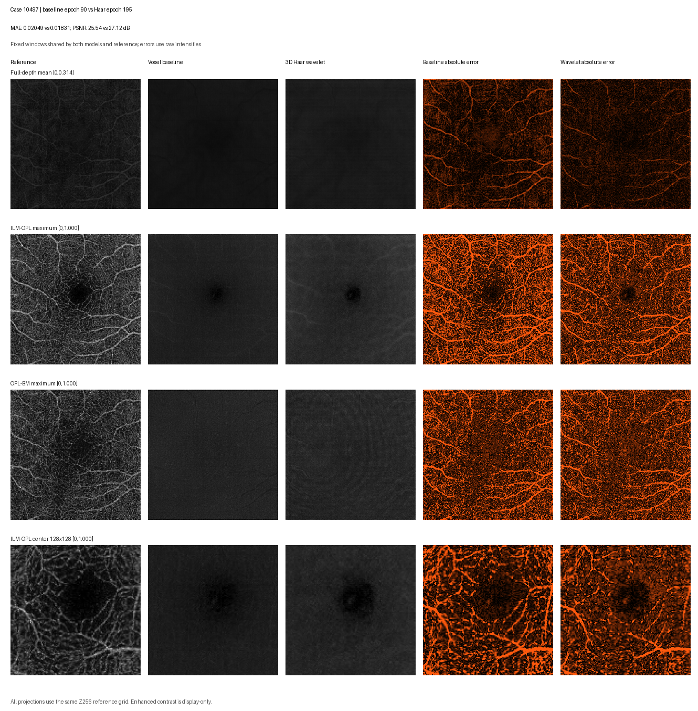
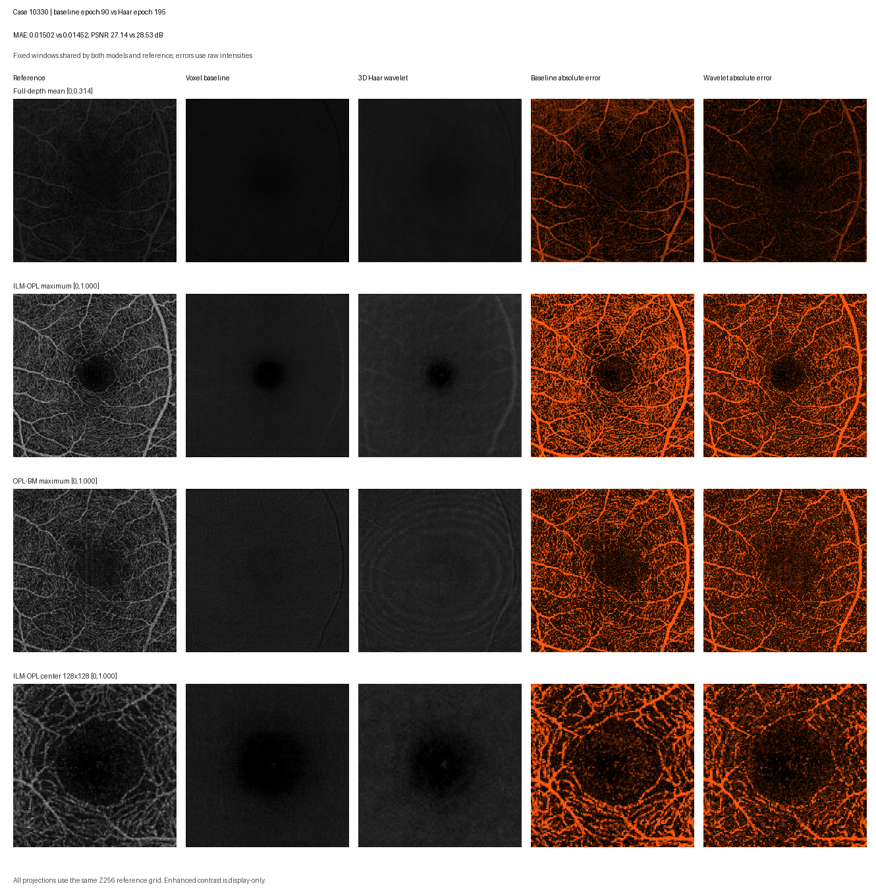
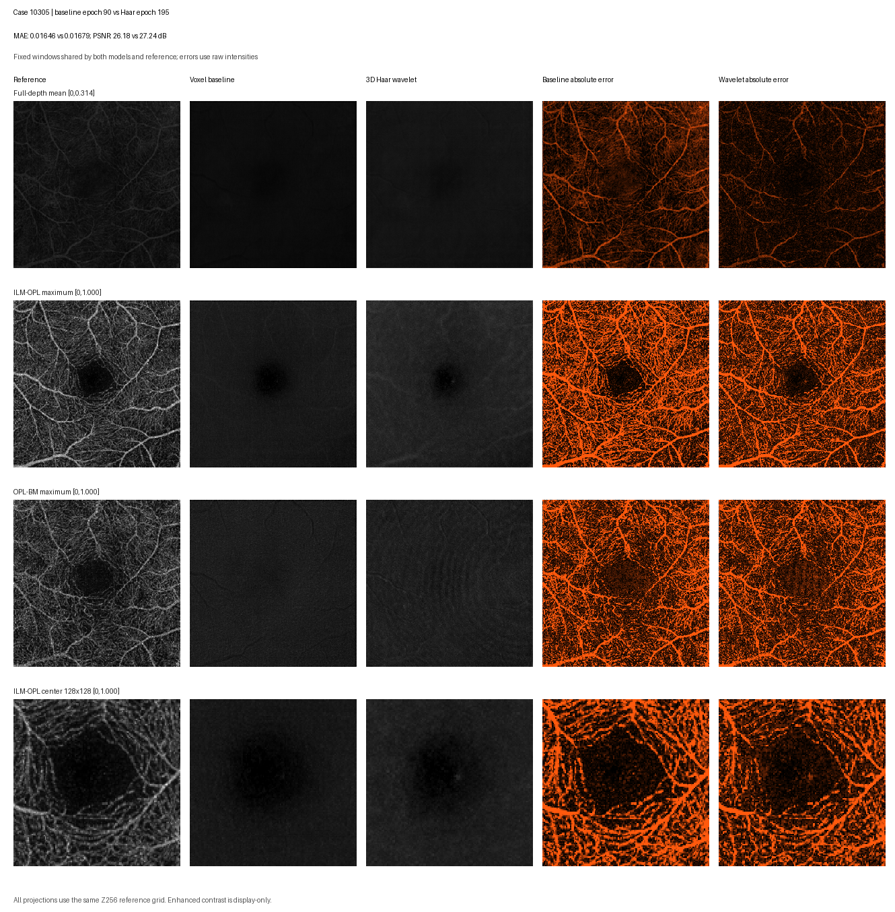
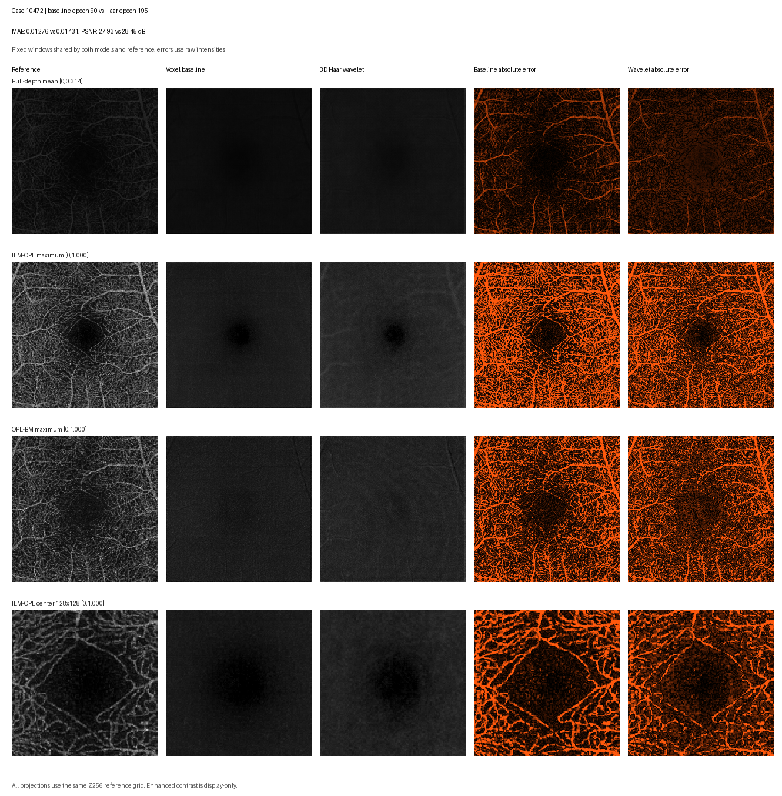
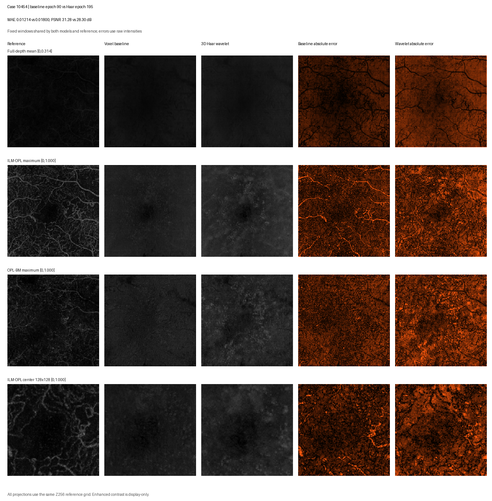

# 3DFM 与三维 Haar：代码审阅所需的实验材料

整理日期：2026-10-22。本目录从已经完成的实验报告中整理图表与数值，没有重新训练、重新推理或重新选择模型。
它用于帮助审阅者同时理解实现与实际表现。先读本页，再看 [代码审阅指南](CODE_REVIEW_GUIDE.md)。

**本目录对应基线 100 轮实验与小波 200 轮实验。基线后来续训到 200 轮的评价未包含在这个快照中。**
两种方法的测试集和主要输入协议相同，训练预算不同；以下结果不能单独证明小波表示的因果收益。

## 实际实验配置

| 项目 | 3DFM 基线 | 3DFM + 3D Haar |
| --- | --- | --- |
| 数据 | OCTA-500 3M，140 训练 / 10 验证 / 50 测试 | 相同划分，清单哈希相同 |
| 输入与几何 | ZYX；固定除以 255；仅轴向深度重采样至 256 | 相同 |
| 体素体块 | 256 × 64 × 64 | 256 × 64 × 64 |
| 网络网格 | 256 × 64 × 64 | 128 × 32 × 32，八个子带 |
| 网络 | 时间条件 3D U-Net，base channels 16，显式 OCT 条件 | 同类主干，首尾通道数变化 |
| 参数量 | 2,097,521 | 2,106,600 |
| 总训练轮数 | **100** | **200** |
| 每轮批次 / batch size | 200 / 1 | 200 / 1 |
| 学习率 / seed / AMP | 2e-4 / 2026 / 开启 | 相同 |
| 成功优化器更新 / AMP 跳过 | 20,000 / 0 | 39,992 / 8 |
| 投影监督权重 | 0 | 0 |
| 验证频率与选择标准 | 每 5 轮，完整体积患者宏平均 MAE 最低 | 相同 |
| 选中权重的轮次 | **90** | **195** |
| 验证 MAE / PSNR | 0.013700 / 28.102 dB | 0.014348 / 28.807 dB |
| 推理 | 从纯 OCT 开始，Euler 8 步，滑窗重叠 0.5 | 相同，统一小波网格积分后重建 |

机器路径已从 [实际配置 JSON](experiment_protocol.json) 中移除。
小波原运行的 `save_every` 为 50；仓库启动脚本中的每 5 轮保存属于后来的使用示例。
相同 seed 和配置值不等于已证明两个实现逐步使用完全相同的随机数或体块序列。

## 训练与验证曲线

[训练记录表](tables/training_history.csv) 包含基线 100 行、小波 200 行；每行保留训练 FM loss、
优化器更新数、AMP 跳过数及当轮存在的验证指标。验证列为空表示当轮没有执行验证。
训练曲线反映采样训练路径上的误差，生成质量应结合从纯 OCT 出发的完整推理结果判断。



下图的圆点与标注统一对应 **验证 MAE 选中的同一个 checkpoint**，PSNR 曲线也沿用该轮次，
没有单独挑选 PSNR 最佳权重。虚线表示第 100 轮；基线曲线止于第 100 轮。


## 50 例成对测试结果

指标先在每个完整预处理体积上计算，再做患者等权平均；本次每例对应一位测试患者。
强度范围固定为 [0,1]，只裁剪最终生成图，PSNR 的 MSE 下限为 1e-12。
均值 PSNR 是逐病例 PSNR 的平均，不是先平均 MSE 后换算的 PSNR。

| 指标 | 基线第 90 轮 | Haar 第 195 轮 | Haar − 基线 | Haar 改善的病例数 |
| --- | ---: | ---: | ---: | ---: |
| 三维体积 MAE ↓ | 0.013878 | 0.014594 | +0.000716（+5.16%） | 21 / 50 |
| 三维体积 PSNR ↑ | 28.322 dB | 28.898 dB | +0.576 dB | 41 / 50 |

MAE 差值的成对 bootstrap 95% 区间为 [+0.000237, +0.001216]，
PSNR 差值区间为 [+0.275, +0.844] dB。抽样单位为配对测试病例，重采样 20,000 次，seed 2026。
这些区间描述这批测试样本的抽样不确定性，未覆盖多种训练随机种子的波动。



| 投影指标 | 基线 | Haar | 观察 |
| --- | ---: | ---: | --- |
| FULL MAE ↓ | 0.008284 | 0.007388 | 均值下降；差值区间略跨 0 |
| FULL PSNR ↑ | 39.755 dB | 40.951 dB | 均值上升 |
| FULL Pearson 相关 ↑ | 0.273 | 0.305 | 均值上升 |
| ILM–OPL MAE ↓ | 0.100869 | 0.084753 | 均值下降约 15.98% |
| ILM–OPL PSNR ↑ | 17.592 dB | 19.055 dB | 均值上升 |
| ILM–OPL Pearson 相关 ↑ | 0.371 | 0.398 | 均值上升 |
| OPL–BM MAE ↓ | 0.083154 | 0.079319 | 均值下降 |
| OPL–BM PSNR ↑ | 19.015 dB | 19.491 dB | 均值上升 |
| OPL–BM Pearson 相关 ↑ | **0.062** | **0.023** | **下降，需结合结构观察** |

FULL 为全深度均值投影；ILM–OPL 与 OPL–BM 为层区间最大值投影。
两种方法在相同 Z256 网格、相同层边界上评价。真实层边界只用于推理后投影，未作为模型输入。
投影误差改善、体积 PSNR 改善与血管结构恢复是不同观察，评审时应分别说明。

完整数值见 [逐例指标](tables/test_metrics.csv)、[汇总指标与区间](tables/summary_metrics.csv)
和 [结构化汇总](metrics_summary.json)。逐例表使用本材料内的 `sample_001` 等标签；没有附原始患者清单、人口统计标签或身份映射。

## 五例对比图

以全体 50 例的 `Haar 体积 MAE − 基线体积 MAE` 升序排列，取第 **1、13、25、38、50** 位，
覆盖改善较多、改善、接近中部、退步与退步较多的情况。这个选图规则是在已有测试结果上用于展示，
不是新的验证集，也没有根据图像观感挑选最佳局部。

| 图 | 本材料编号 | 图中公开数据集编号 | 差值排名 | 基线 MAE | Haar MAE | Haar − 基线 |
| --- | --- | --- | ---: | ---: | ---: | ---: |
| 1 | sample_048 | 10497 | 1 | 0.020485 | 0.018312 | −0.002173 |
| 2 | sample_011 | 10330 | 13 | 0.015020 | 0.014520 | −0.000500 |
| 3 | sample_001 | 10305 | 25 | 0.016456 | 0.016788 | +0.000331 |
| 4 | sample_043 | 10472 | 38 | 0.012761 | 0.014306 | +0.001545 |
| 5 | sample_040 | 10454 | 50 | 0.012142 | 0.017996 | +0.005853 |

图中的数字是原 OCTA-500 数据集的公开样例编号。[选图表](tables/selected_examples.csv) 将五张图与成对指标对应起来。
图片为已有科学对比面板的原样副本；[来源校验信息](figure_provenance.json) 记录文件 SHA-256。

**读图方式：**固定窗图从左到右依次为真实 OCTA、基线预测、小波预测、基线绝对误差、小波绝对误差。
各行依次为 FULL、ILM–OPL、OPL–BM，以及固定的 ILM–OPL 中心 128×128 区域。
FULL 显示范围为 [0,80/255]；两个分层最大值投影为 [0,1]。
误差窗 FULL 为 [0,0.05]，分层为 [0,0.2]。亮度窗在真实图和两组模型之间保持一致。

每例另附增强窗链接，对每张图分别使用 [0,P99]，只用于观察形态；绝对亮度比较应看固定窗图。
所有数值指标均来自未拉伸的原始浮点结果。

### 图 1：体积 MAE 改善最多



[查看图 1 的独立 P99 增强窗](figures/example_01_enhanced.png)

### 图 2：体积 MAE 改善



[查看图 2 的独立 P99 增强窗](figures/example_02_enhanced.png)

### 图 3：差值排序接近中部



[查看图 3 的独立 P99 增强窗](figures/example_03_enhanced.png)

### 图 4：体积 MAE 退步



[查看图 4 的独立 P99 增强窗](figures/example_04_enhanced.png)

### 图 5：体积 MAE 退步最多



[查看图 5 的独立 P99 增强窗](figures/example_05_enhanced.png)

## 如何复核

脚本只读取本目录的配置、汇总和 CSV，无需访问原始医学体积或模型权重。
依赖 NumPy 与 Matplotlib。在仓库根目录运行：

```bash
python docs/review/reproduce_summary.py --output runs/review_recheck
```

它核对 50 例配对关系、300 条轮次记录、最佳验证轮次、11 组指标及其 bootstrap 区间和五例选图排名，
然后输出重算 JSON、训练曲线、验证曲线和测试散点图。
它复核的是已导出的指标与记录；从医学体积重算基础指标、重跑推理或核验患者分组需要本地数据与权重。

## 使用这些材料时的边界

本次只有一个 seed，且两组预算不同。比较表示方式的效果还需要匹配训练预算、重复 seed，并预先确定主指标。
仓库保留了后来新增的投影监督入口，但本目录这两组结果的投影监督权重均为 0。
没有从低训练 loss 推断血管结构已经恢复，也没有把使用真实 OCTA 的插值中间状态当作自由生成效果。
本包暂未整理两组配对的 B-scan 对比和完整体积结果；现有对比图展示的是推理后的投影。

## 数据来源与引用

样例图源自 OCTA-500 3M 的本项目研究结果，用于学术讨论与代码审阅。
原始数据请从 [OCTA-500 官方入口](https://ieee-dataport.org/open-access/octa-500) 获取，使用时遵守其学术研究条款并引用原始工作。

- Mingchao Li et al. *OCTA-500: A retinal dataset for optical coherence tomography angiography study.* Medical Image Analysis, 93, 103092, 2024. [DOI](https://doi.org/10.1016/j.media.2024.103092)
- Mingchao Li et al. *Image Projection Network: 3D to 2D Image Segmentation in OCTA Images.* IEEE Transactions on Medical Imaging, 39(11), 3343–3354, 2020. [DOI](https://doi.org/10.1109/TMI.2020.2992244)
