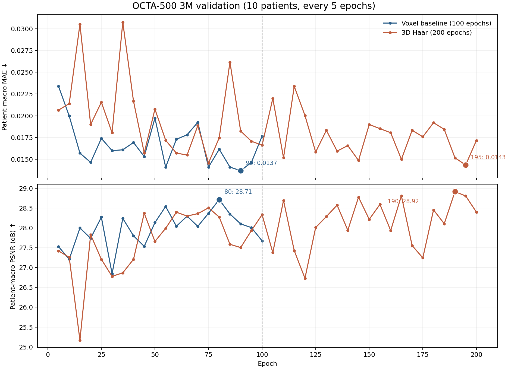
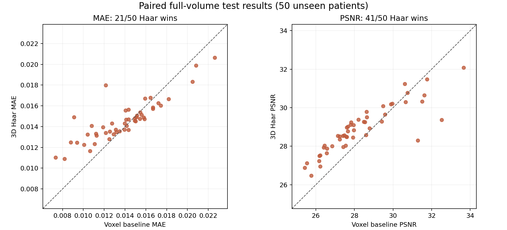

# 3D Haar 小波流匹配：200 轮训练结果分析

## 结论

200 轮训练正常完成，最佳模型是第 **195** 轮，不是最后的第 200 轮。在同一 OCTA-500 3M 划分的 50 位独立测试患者上，Haar 小波模型的三维体积 **MAE 比原始 3D FM 基线高 5.16%**（较差），但 **PSNR 高 0.576 dB**（较好）。分层投影误差总体改善，尤其 ILM–OPL；OPL–BM 的投影相关系数却下降。因此目前是指标之间的权衡，不能笼统宣称“加小波全面提升”。

## 协议与训练状态

两组使用同一清单及划分（`manifest_sha256=652544a427071b8350d346deb941c03182ae4e248659b1117a45fcb870bc253b`）、3M 视野、`256×64×64` **体素**块、base channels 16、batch size 1、每轮 200 个 batch、学习率 2e-4、每 5 轮验证、8 步 Euler 推理和 0.5 重叠。基线网络约 2,097,521 参数，小波网络约 2,106,600 参数。区别是体素域与单层 3D Haar 系数域，以及基线训练 100 轮、小波训练 200 轮；因轮数不同，单凭这两次运行不能完全归因于表示方式。

小波训练日志连续记录第 1–200 轮，完成 39,992 次优化器更新，AMP 跳过 8 次更新，没有中断或非有限推理错误。前 100 轮最低验证 MAE 出现在第 75 轮（0.014576）；训练到第 195 轮降至 0.014348，仅再改善约 1.56%。第 200 轮的验证 MAE 为 0.017173，比最佳值高 19.69%，说明应使用验证集选出的权重；曲线后期仍刷新最佳值，没有持续恶化的过拟合趋势。FM 训练损失在不同表示域中不可直接比较。

| 验证集，10 位患者 | 基线最佳：第 90 轮 | Haar 最佳：第 195 轮 | Haar 相对基线 |
|---|---:|---:|---:|
| 三维体积 MAE ↓ | 0.013700 | 0.014348 | 高 4.73% |
| 三维体积 PSNR ↑ | 28.102 dB | 28.807 dB | 高 0.704 dB |

## 独立测试集：同一批 50 位患者

两组均用验证 MAE 最低的权重，测试集不参与选轮或调推理参数。逐患者计算完整预处理体积上的 MAE/PSNR，再对患者做等权平均；两组同为 8 步 Euler。

| 三维体积指标 | 基线第 90 轮 | Haar 第 195 轮 | Haar 差值 | Haar 更好的患者数 |
|---|---:|---:|---:|---:|
| MAE ↓ | 0.013878 | 0.014594 | **+0.000716（+5.16%，较差）** | 21/50 |
| PSNR ↑ | 28.322 dB | 28.898 dB | **+0.576 dB（较好）** | 41/50 |

按患者成对重采样 20,000 次所得差值 95% 百分位区间：MAE 为 **[+0.000237, +0.001216]**；PSNR 为 **[+0.275, +0.844] dB**。这两个区间均不跨 0，但只反映本测试集的抽样不确定性，不代表跨设备或跨中心的临床泛化。MAE 最大退步的病例为 10454（+0.00585）和 10415（+0.00580）；最大改善为 10497（−0.00217）和 10430（−0.00196）。

## 分层投影补充评价

采用与基线相同的 50 例及投影标注，**只在推理后**使用真实层边界计算投影，不向生成模型输入层标注。FULL 为全层均值投影；ILM–OPL 与 OPL–BM 为层区间最大值投影。指标在同一 Z256 参考网格、未拉伸的 `[0,1]` 数值上计算。

| 投影 | MAE：基线 → Haar ↓ | PSNR：基线 → Haar ↑ | Pearson 相关：基线 → Haar ↑ |
|---|---:|---:|---:|
| FULL | 0.008284 → **0.007388** | 39.755 → **40.951 dB** | 0.273 → **0.305** |
| ILM–OPL | 0.100869 → **0.084753** | 17.592 → **19.055 dB** | 0.371 → **0.398** |
| OPL–BM | 0.083154 → **0.079319** | 19.015 → **19.491 dB** | **0.062 → 0.023（下降）** |

ILM–OPL 的投影 MAE 改善约 15.98%，50 例中 47 例改善。FULL 的平均投影 MAE 虽下降，但成对重采样区间略跨 0（差值区间约 `[−0.001795, +0.000032]`），不宜把这个单项说成稳定改善。OPL–BM 的相关系数本来就低，Haar 还进一步下降；因此投影误差更小不等同于血管拓扑或细血管质量必然更好。建议定性查看 10415、10454 等退步病例，并在固定协议下补充血管结构指标。

## 权重与后续使用

服务器主权重：`/srv/oct_research/fm3d_wavelet_200/runs/fm3d_haar3d_3M_200/best.pt`，内部轮次为 195。`best_through_0195.pt` 和 `best_through_0200.pt` 与它的 SHA-256 完全一致；`epoch_0200.pt` / `latest.pt` 是第 200 轮的当前权重，不能代替最佳模型。原训练命令每 50 轮保存一次，后来补加的每 5 轮监控共保留 29 个截至当前最佳的快照；早期 11 个间隔的当时权重已无法精确重建。第 200 轮由主训练进程先保存了快照，监控进程因重复文件报错；已修复监控的重复运行处理并复验，训练结果和最佳权重没有受影响。

如果主要目标是 **三维体积 MAE**，目前应继续采用基线；如果主要目标是 **PSNR 或 ILM–OPL 投影误差**，Haar 值得保留，但需同时报告 OPL–BM 相关性的退步。下一轮研究应先固定相同训练预算、至少增加随机种子，并明确主指标；若目标仍是 MAE，可考虑系数域训练时同时约束重建体积的 L1 误差，而不是继续单纯增加轮数。

可复核的数据：[`analysis_summary.json`](analysis_summary.json)、[`test_patient_comparison.csv`](test_patient_comparison.csv)、[`make_analysis.py`](make_analysis.py)。服务器的测试结果和投影报告分别在 `runs/fm3d_haar3d_3M_200_test_best195_20261021`、`runs/fm3d_haar3d_3M_200_test_best195_20261021_projection_report`，均位于 `/srv/oct_research/fm3d_wavelet_200/` 下。
