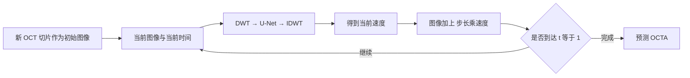

# FlowOCT 逐段精读：从 Python 的 self 到独立编写实验代码

日期：2026-10-09。

本文专门解释这次粘贴的 288 行代码。已核对：粘贴文本与 [upstream/models/FlowOCT_model.py](../upstream/models/FlowOCT_model.py) 一致。网络接口另对照本机 PyTorch 2.5.1+cu121、MONAI 1.4.0 源码。以下讲的是代码实际行为。

配套练习：[learning/04_python_and_flowoct.py](../learning/04_python_and_flowoct.py)。它在 CPU 上用小尺寸人工数据演示 self、形状、端点公式、梯度、投影索引和对比损失，无需医学数据。文中的建议代码与原模型的实际行为会分别说明。

推荐阅读顺序：先看 1–4 节，理解对象和配置；再看 5–7 节，跟踪数据；接着读损失和生成；最后完成练习，再写自己的最小实验。第一次阅读不必记住每个库函数。

## 1. 这份文件究竟负责什么

它定义了一个名叫 `FlowOCT` 的模型类。创建这个类的对象后，可以给它数据、执行一次训练更新、生成预测 OCTA、记录损失、保存和加载权重。

这里有三种不同的东西：

| 名称 | 本质 | 在本代码中的作用 |
|---|---|---|
| `FlowOCT` | 类 | 规定模型对象有哪些属性、方法 |
| `model = FlowOCT(opt)` | 类的一个实例，即对象 | 保存当前实验的网络、配置、输入、损失等状态 |
| `model.netG` | 这个对象内部的一个神经网络 | 根据中间图像和时间预测变化速度 |

`netG` 的 G 是变量命名，文件里没有判别器，也没有对抗损失；不能仅凭 G 就把它理解成 GAN。

**训练的主线：**


**生成的主线：**



训练改变参数 θ；生成改变图像状态 x。理解这一区别后，`backward()` 和 Euler 循环就不会混在一起。

## 2. 先弄懂 Python：class、对象、self、属性和方法

### 2.1 class 是类型定义；对象是实际使用的实例

```python
class Experiment:
    def __init__(self, run_name):
        self.run_name = run_name
        self.steps = 0

    def record_step(self):
        self.steps += 1
        message = f'{self.run_name}: step {self.steps}'
        return message

first = Experiment('baseline')
second = Experiment('ablation')
print(first.record_step())
print(first.steps, second.steps)
```

输出分别是 `baseline: step 1` 和 `1 0`。两个对象各自保存自己的 `steps`。

### 2.2 self 指本次调用方法的那个对象

调用：

```python
first.record_step()
```

Python 会把 `first` 自动作为方法的第一个参数传进去。在本例中相当于：

```python
Experiment.record_step(first)
```

所以方法里的 `self.steps` 就是 `first.steps`。当第二个对象调用同一方法时，`self` 就指向第二个对象。`self` 不是 Python 关键字，是大家遵守的参数命名惯例。[Python 官方类教程](https://docs.python.org/3/tutorial/classes.html)

对应原代码：

```python
model = FlowOCT(opt)
model.set_input(batch)
```

执行 `set_input(self, input)` 时，`self` 是 `model`，`input` 是 `batch`。无需手工写 `model.set_input(model, batch)`。

### 2.3 self.xxx 与普通局部变量有什么区别

```python
def set_input(self, input):
    self.real_A = input['A']
```

`real_A` 挂在对象上。以后 `forward()`、`test()` 都能通过 `self.real_A` 找到它。

```python
def forward(self):
    oct_flat = ...
```

`oct_flat` 是这个方法调用中的局部变量，其他方法不能通过 `self.oct_flat` 直接访问。方法结束后，局部名称不再供其他方法使用；被返回或被其他对象引用的值可以继续存在。

判断一个量是否应写成 `self.xxx`，可以问：其他方法是否还要使用它？它是否是这个对象需要长期保存的状态？

不是所有 `self.xxx` 都是可训练参数。`self.vweight` 是浮点数，`self.real_A` 是数据张量，`self.netG` 是子模块。可训练参数通常由层内部的 `nn.Parameter` 表示。

### 2.4 __init__、继承和 super

```python
class FlowOCT(nn.Module):
    def __init__(self, opt):
        super().__init__()
```

`FlowOCT(nn.Module)` 表示继承 PyTorch 的模块基类。`__init__` 是创建实例后自动调用的初始化方法；它准备对象，不需要 `return model`。

`super().__init__()` 在当前继承结构中调用 `nn.Module` 的初始化逻辑，建立子模块、参数等管理机制。随后把网络赋给 `self.netG`，PyTorch 才能把它登记成子模块，并让 `model.parameters()`、`model.state_dict()`、`model.eval()` 等操作访问它。[PyTorch nn.Module 文档](https://docs.pytorch.org/docs/stable/generated/torch.nn.Module.html)

`super()` 返回用于按继承顺序访问父类实现的代理；它不代表另一个独立模型。

### 2.5 方法怎么调用，返回值怎么接收

```python
def name(self):
    return 'FlowOCTModel'
```

`model.name` 是方法对象；`model.name()` 才执行方法，得到字符串。这个方法只提供名称，未参与预测。

`return` 结束函数并交出结果；没有显式 `return` 的函数默认返回 `None`。原代码的 `forward()` 没有返回预测，而是把损失存在对象上并完成更新。

`_load_checkpoint` 前面的单下划线表示内部辅助方法的命名惯例，外部仍可以调用。`__init__` 前后双下划线则是 Python 的特殊方法名称，含义不同。

## 3. 文件开头和初始化：给整个实验准备组件

### 3.1 import 和文档字符串

文件第一行的三引号字符串是模块文档字符串。方法开头同样形式的文字是方法文档字符串，可以被帮助工具读取。`# ...` 是普通注释。

| 原代码 | 意思 | 是否在粘贴文件中实际使用 |
|---|---|---|
| `import os` | 导入操作系统/路径工具模块 | 使用了路径拼接和创建目录 |
| `import time` | 导入时间工具 | 未使用 |
| `from collections import OrderedDict` | 导入有序字典类型 | 组织损失日志 |
| `import numpy as np` | 导入 NumPy 并起别名 np | 未通过 np 使用 |
| `import torch` | 导入 PyTorch | 创建和计算张量、优化、保存等 |
| `import torch.nn as nn` | 给神经网络模块起别名 nn | 层、模块基类、损失函数 |
| `import torch.nn.functional as F` | 函数形式的神经网络运算 | 归一化和交叉熵 |
| `from ... import DiffusionModelUNet` | 从 MONAI 导入这个类 | 主速度网络 |
| `from tqdm import tqdm` | 导入进度条工具 | 在这个文件中未使用 |
| `from util... import ...` | 导入本项目提供的工具 | 小波与自动裁剪 |

`as` 是起别名。`nn.Conv2d` 表示访问 nn 模块里的 Conv2d。虽然这里没有使用 `np`，张量的 `.numpy()` 仍会返回 NumPy 数组，它是张量的方法。

### 3.2 opt 是配置对象

```python
self.opt = opt
self.isTrain = opt.isTrain
self.save_dir = os.path.join(opt.checkpoints_dir, opt.name)
```

项目里 `opt` 来自命令行解析。你可以把它看成包含 `lr`、`gpu_ids`、`name` 等属性的配置对象；`opt.lr` 是用点号访问属性，不是字典索引。

教学时可手工构造小配置：

```python
from types import SimpleNamespace
opt = SimpleNamespace(lr=1e-4, gpu_ids=[0], name='baseline')
print(opt.lr)
```

这个小例子只有三个属性，不足以直接初始化完整 FlowOCT；完整模型还访问 `isTrain`、`checkpoints_dir`、`beta`、`continue_train` 等。

`self.opt = opt` 保存的是对同一个配置对象的引用，不自动深拷贝。`os.path.join` 按系统路径规则拼接检查点目录与实验名。

### 3.3 GPU、条件表达式和 f-string

```python
self.device = torch.device(f'cuda:{opt.gpu_ids[0]}') if opt.gpu_ids else torch.device('cpu')
```

把它展开就是：

```python
if opt.gpu_ids:
    self.device = torch.device(f'cuda:{opt.gpu_ids[0]}')
else:
    self.device = torch.device('cpu')
```

空列表 `[]` 的真假判断为假，非空列表为真；`[0]` 表示取第一个元素；`f'cuda:{...}'` 把花括号里的结果插入字符串，例如得到 `cuda:0`。

这个判断只检查配置列表，没有检查 CUDA 是否可用。给了 GPU 编号却没有可用 GPU，后面的 `.to(self.device)` 可以报错。本文件只使用第一个 GPU 编号。

`torch.device` 描述目标设备；真正把网络或数据搬过去，是后面的 `.to(...)`。

### 3.4 初始化主网络

```python
self.netG = DiffusionModelUNet(
    spatial_dims=2,
    in_channels=4,
    out_channels=4,
).to(self.device)
```

这里先创建网络对象，再把参数和已登记的缓冲量移动到目标设备。`spatial_dims=2` 表示二维空间运算；4 个输入通道来自单通道图像的小波四频带；4 个输出通道代表预测速度的四个频带。

输入、输出通道数都为 4，不代表网络内部只用 4 个通道。对照 [本机 MONAI 1.4.0 源码](D:/software/anaconda3/envs/flowoct/Lib/site-packages/monai/networks/nets/diffusion_model_unet.py:1535)，这里未写出的默认配置包括：

```python
channels = (32, 64, 64, 64)
num_res_blocks = (2, 2, 2, 2)
attention_levels = (False, False, True, True)
with_conditioning = False
```

它具有下采样、残差块、时间嵌入、注意力、跳跃连接和上采样。网络名称含 Diffusion，不决定训练算法；这里让它学习速度，使用的是本文件构造的 flow matching 目标。

构造网络时还没有输入任何图像。稍后 `self.netG(x_t_dwt, t)` 才会执行网络计算。一般应通过 `net(x)` 调用模块，让 PyTorch 的模块调用机制转入 `forward()`。

### 3.5 小波与对比学习投影头

```python
self.dwt_2d = DWT_2D('haar')
self.idwt_2d = IDWT_2D('haar')
```

Haar 小波是固定的线性变换。本项目这两个层没有可训练权重，但内部提供了反向传播实现，因此通过 IDWT 的梯度可以传到前面的网络。

```python
self.contrast_projection_head = nn.Sequential(
    nn.Conv2d(1, 64, 3, padding=1),
    nn.ReLU(),
    nn.AdaptiveAvgPool2d((1, 1)),
    nn.Flatten(),
    nn.Linear(64, 128),
).to(self.device)
```

`nn.Sequential` 按顺序把前一层输出交给后一层。对于 M 张单通道切片：

```text
(M,1,H,W)
  → Conv2d：用 3×3 卷积得到 (M,64,H,W)
  → ReLU：把负激活截为 0，形状不变
  → 平均池化到 1×1：(M,64,1,1)
  → Flatten：默认保留批维，得到 (M,64)
  → Linear：得到 (M,128)
```

`padding=1` 配合 3×3 卷积和默认 stride=1，保持 H、W。128 维特征用于对比损失，并不直接作为 OCTA 输出。这个投影头与后面的“最大强度投影”是两种不同操作。

### 3.6 损失和优化器

```python
self.criterionL1 = nn.L1Loss()
self.criterionL2 = nn.MSELoss()
```

前者默认求各元素绝对误差的均值；后者默认求平方误差的均值。这里名字叫 L2，实际实现是 MSE，不是平方误差开根号后的欧氏范数。

四个 `self.xxxweight` 是手动设置的超参数，不会被 Adam 自动学习。

```python
params = list(self.netG.parameters()) + list(self.contrast_projection_head.parameters())
self.optimizer_G = torch.optim.Adam(params, lr=opt.lr, betas=(opt.beta, 0.999))
```

`.parameters()` 枚举模块参数；`list(...)` 将其收集成列表；两个列表之间的 `+` 是连接，不是把参数数值相加。`lr` 是学习率，`betas` 是 Adam 的两个动量衰减系数，圆括号构造元组。

优化器管理两个网络的参数。DWT 没有训练参数，所以未列入。创建优化器只做准备，真正更新发生在 `.step()`。

优化器只在 `self.isTrain` 为真时创建。因此测试配置下不能调用本文件的 `forward()` 来生成图片，它会访问不存在的优化器。

### 3.7 检查点与生成步数

```python
if not self.isTrain or opt.continue_train:
    self._load_checkpoint(opt.epoch)
self.generation_steps = 3
```

`not` 取反，`or` 表示或。测试模式或选择继续训练时，加载已有权重。`opt.epoch` 在这里用于组成文件标签；不一定是整数，`latest` 或具体检查点名也可以作为字符串标签。

`_load_checkpoint` 只是调用 `self.load(epoch)` 并打印信息。`generation_steps=3` 指生成时的 Euler 时间步数量，与训练 epoch、网络层数无关。

## 4. set_input：把一批数据交给对象

```python
def set_input(self, input):
    self.real_A = input['A'].to(self.device, dtype=torch.float)
    self.real_B = input['B'].to(self.device, dtype=torch.float)
```

外部数据加载器给出字典：`{'A': OCT张量, 'B': OCTA张量, ...}`。方括号加字符串是按键取值。`.to(...)` 转换设备与数据类型，`torch.float` 对应 float32。

这个方法做数据搬运，没有执行神经网络。输入的预期形状都是 `(B,C,D,H,W)`，配对数据应对齐；本文件没有主动验证这些条件。

参数名 `input` 遮蔽了 Python 内置的 `input()` 函数。这里不会影响运行，但自己写代码时用 `batch` 更清楚：

```python
def set_input(self, batch):
    self.real_A = batch['A'].to(self.device, dtype=torch.float32)
```

## 5. forward 前半段：三维数据怎样变成二维网络输入

### 5.1 看懂 shape 和解包

```python
B, C, D, H, W = self.real_A.shape
```

`.shape` 给出每个轴的长度；左侧多个变量接收序列中的各项，叫解包。这里约定 B 是体数据的批量数、C 是通道数、D 是切片轴长度、H/W 是切片的高/宽。

示例采用 `(2,1,8,32,32)`：一批两个体，每个体单通道、8 张切片，每张 32×32。本代码硬编码的主网络和投影头实际要求 C=1。

`D` 是程序对第三个轴的命名，不能仅凭名字确定它在原始 OCT 中代表哪一个解剖方向。需要对照数据转换和轴定义。

### 5.2 抽配对切片

```python
num_slices = max(1, D // 4)
indices = torch.randperm(D, device=self.device)[:num_slices]
oct_slices = self.real_A[:, :, indices, :, :]
octa_slices = self.real_B[:, :, indices, :, :]
```

`//` 是向下取整的整数除法，8//4=2；`max(1,...)` 保证正 D 时至少取一张。`randperm(D)` 随机排列 0 到 D-1，不重复；`[:num_slices]` 取前 num_slices 项。

同一个 `indices` 用于 OCT 与 OCTA，保证取出的训练对来自同一位置。当前实现也让同批各个体使用同一组切片编号。若示例 indices 为 `[1,4]`，形状从 `(2,1,8,32,32)` 变成 `(2,1,2,32,32)`。

多维索引中每个逗号对应一个轴；`:` 表示保留这个轴的所有项；`indices` 表示在第三轴选多个位置。

### 5.3 permute 和 reshape 为什么连用

```python
oct_flat = oct_slices.permute(0, 2, 1, 3, 4).reshape(-1, C, H, W)
```

`permute(0,2,1,3,4)` 按原轴编号重新排列轴：

```text
(B,C,N,H,W) → (B,N,C,H,W)
(2,1,2,32,32) → (2,2,1,32,32)
```

再用 `reshape(-1,C,H,W)` 合并相邻 B、N 两个轴：

```text
(B,N,C,H,W) → (B×N,C,H,W)
(2,2,1,32,32) → (4,1,32,32)
```

`-1` 表示根据总元素数自动算出该轴长度，不表示负的维度。后文用 M=B×N 代表二维切片批量，以免把它误认成原来的 D。

`permute` 改轴顺序，`reshape` 改形状但不改变元素总数。对一般多通道输入，先把 N 放到 C 前面才能按预期合并 B 与 N。`permute` 常得到不连续视图，`reshape` 必要时会复制数据；不能把 `view` 当成所有情形都可直接互换的替代。

**即使输入输出为五维，主网络接收的依然是四维二维切片。D 被移入了样本维，二维卷积不会直接建模不同切片之间的空间邻接。**

## 6. flow matching：网络为什么预测速度

### 6.1 t 的采样和广播

```python
t = torch.rand(oct_flat.shape[0], device=self.device)
t_img = t.view(-1, 1, 1, 1)
```

`torch.rand(M)` 给每张切片一个 [0,1) 中的随机时间，t 形状是 `(M,)`。`view` 把同样的数值组织为 `(M,1,1,1)`，对应四维图像批量。

广播按右侧的轴对齐，大小为 1 的轴可以扩展。这样 t_img[i] 会作用于第 i 张切片的所有通道和像素。若直接让 `(M,)` 与 `(M,C,H,W)` 相乘，M 会尝试与 W 对齐，可能报错，也可能在尺寸恰好相等时悄悄沿错误方向计算。[PyTorch 广播规则](https://docs.pytorch.org/docs/stable/notes/broadcasting.html)

网络需要的时间输入仍是 `(M,)` 的 t；t_img 专用于图像插值。

### 6.2 插值与监督目标

```python
x_t = (1 - t_img) * oct_flat + t_img * octa_flat
dx_t = octa_flat - oct_flat
```

记 x₀ 为 OCT、x₁ 为真实 OCTA：

\[
x_t=(1-t)x_0+t x_1,
\qquad u=\frac{d x_t}{dt}=x_1-x_0.
\]

t=0 时 x_t 是 OCT；t=1 时是 OCTA；中间时间是两者的线性混合。`dx_t` 是这条线性路径对时间的导数，即目标速度，不是学习率，也不是离散一步的图像增量。实际一步增量还要乘时间步长。

这里的起点来自 OCT，而不是随机高斯噪声。随机性来自训练中的切片抽样和时间抽样。

单像素例子：x₀=0.2、x₁=0.8、t=0.25，则 x_t=0.35，目标速度 u=0.6。速度可以为正或负：某些像素需要变亮，另一些需要变暗。

### 6.3 为什么网络要同时看到 t

图像值相似的中间状态可能出现在不同阶段，网络需要知道当前时间。代码学习的是 `v_θ(x_t,t)`，θ 表示主网络所有可训练参数的集合。

具体输入是 DWT(x_t) 和 t，没有把固定的原始 OCT 作为额外条件通道或 context 再传一次。原始 OCT 用来构造训练路径、提供生成起点。“源图作为起点”和“每一步额外输入源图”是两种不同设计，需要从实际调用参数判断。

## 7. DWT → netG → IDWT：预测速度的完整计算

```python
LL, LH, HL, HH = self.dwt_2d(x_t)
x_t_dwt = torch.cat([LL, LH, HL, HH], dim=1)
pred_dx_dwt = self.netG(x_t_dwt, t)
pred_dx = self.idwt_2d(
    pred_dx_dwt[:, 0:1], pred_dx_dwt[:, 1:2],
    pred_dx_dwt[:, 2:3], pred_dx_dwt[:, 3:4],
)
```

### 7.1 四个频带是什么

LL 捕获低频总体结构，LH/HL 分别捕获两个方向的高频变化，HH 捕获双方向高频细节。具体把哪个方向叫水平或垂直，需要服从实现中的轴约定。

本项目 [DWTFunction_2D](../upstream/util/DWT_IDWT_Functions.py) 的实际计算是：

```text
LL = L_H × x × L_Wᵀ
LH = L_H × x × H_Wᵀ
HL = H_H × x × L_Wᵀ
HH = H_H × x × H_Wᵀ
```

这里下标 H/W 指作用的空间轴，L/H 分别指低通/高通。以函数实现为准；小波层部分说明字符串的 LH/HL 方向描述与该实现并不完全一致。

对于偶数 H、W：

| 阶段 | 通用形状（C=1） | 当前示例 |
|---|---|---|
| x_t | `(M,1,H,W)` | `(4,1,32,32)` |
| 每个频带 | `(M,1,H/2,W/2)` | `(4,1,16,16)` |
| 拼接四频带 | `(M,4,H/2,W/2)` | `(4,4,16,16)` |
| 网络输出 | `(M,4,H/2,W/2)` | `(4,4,16,16)` |
| IDWT 速度 | `(M,1,H,W)` | `(4,1,32,32)` |

`torch.cat([...],dim=1)` 沿通道轴连接，不增加新轴。四个频带全部保留时，4×H/2×W/2=H×W，元素总数没有减少；空间分辨率变小、通道数变多，不能简单视作丢弃信息的压缩。

### 7.2 0:1 为什么不能随便换成 0

```python
pred_dx_dwt[:, 0:1]  # (M,1,H/2,W/2)
pred_dx_dwt[:, 0]    # (M,H/2,W/2)
```

切片 `0:1` 保留一个长度为 1 的通道轴；整数索引 `0` 删除该轴。IDWT 需要四维频带，所以这里保留通道轴。

切片的停止端不包含在内，`0:1` 取第 0 个通道，`1:2` 取第 1 个通道，以此类推。

### 7.3 图像域速度的统一表达

把上面的四句写成数学形式：

\[
\hat u = \operatorname{IDWT}\bigl(G_\theta(\operatorname{DWT}(x_t),t)\bigr).
\]

主网络输出的是速度的小波表示，IDWT 后才得到与图像同形状的速度。文件把这个过程写了两次：训练时用于算损失，Euler 生成时用于更新图像。

### 7.4 如何从当前状态估计 OCTA 端点

```python
pred_octa_flat = x_t + (1 - t_img) * pred_dx
pred_octa_flat = torch.clamp(pred_octa_flat, 0, 1)
```

因为目标路径的理想速度为常量 u：

\[
x_t+(1-t)u=(1-t)x_0+t x_1+(1-t)(x_1-x_0)=x_1.
\]

因此代码用预测速度估计端点。上面的单像素例子：0.35+0.75×0.6=0.8。

这个端点公式用于训练中的辅助损失。它不等于执行了三步生成，也不证明一个学到的、沿状态变化的速度场可以从任意时间一次准确积分到终点。

`clamp(x,0,1)` 将低于 0 的值截为 0、高于 1 的值截为 1。区间外的这条输出分支通常梯度为零；速度损失仍直接约束未截断的 pred_dx。

在不截断时还能推导：`预测端点 − 真端点 = (1−t)×(预测速度 − 目标速度)`。这说明端点重建与速度监督存在联系，接近 t=1 时，端点误差对速度误差更不敏感。

## 8. 四项损失分别在约束什么

```python
self.loss = (
    10.0 * self.vloss
    + 0.5 * self.L1loss
    + 0.005 * self.contrastloss
    + 0.1 * self.proj_loss
)
```

| 损失 | 比较对象 | 希望得到的行为 |
|---|---|---|
| vloss | 预测速度 pred_dx 与目标速度 dx_t | 学到正确的变化方向和幅度 |
| L1loss | 估计的 OCTA 端点与真实 OCTA | 端点像素强度接近真实数据 |
| contrastloss | 配对切片的 128 维特征 | 配对特征相似、与其他切片区分 |
| proj_loss | 预测/真实切片的最大值投影 | 投影后的结构接近 |

系数更大不等于实际影响一定更大，还要看各项数值量级以及它们产生的参数梯度。要通过日志与消融判断权重作用。

### 8.1 _cropped_l2_loss 和 _cropped_l1_loss

这两个方法结构相同，只有内部 criterion 不同：

```python
loss = 0.0
for i in range(pred.shape[0]):
    _, _, bbox = auto_crop_octa_images(
        pred[i].detach().cpu().numpy().squeeze(0),
        target[i].detach().cpu().numpy().squeeze(0),
    )
    xm, ym, xM, yM = bbox['expanded_bbox']
    loss += self.criterionL2(
        pred[i, :, ym:yM+1, xm:xM+1],
        target[i, :, ym:yM+1, xm:xM+1],
    )
return loss / pred.shape[0]
```

逐句阅读：

1. `loss=0.0` 准备累加器，第一次加张量损失后会得到张量。
2. `range(M)` 给出 0 到 M-1，循环每张切片。
3. `pred[i]` 取第 i 张，得到 `(1,H,W)`。
4. `.detach()` 创建脱离自动求导图的张量视图；`.cpu()` 放到 CPU；`.numpy()` 交给 NumPy 工具；`.squeeze(0)` 删除大小为 1 的通道轴，得到 `(H,W)`。
5. 裁剪函数返回三个值；两个 `_` 表示前两个返回值在这里不使用，保留 bbox 字典。
6. 字典中 `expanded_bbox` 是 `(x_min,y_min,x_max,y_max)`，通过解包交给四个变量。
7. 在**原始 PyTorch 张量**上切出 ROI，计算均值误差。ROI 指 region of interest，即感兴趣区域。
8. `+=` 是累加；最后除以切片数，得到各张切片损失的平均。

`yM+1`、`xM+1` 是因为 bbox 最大坐标包含边界，而 Python 切片不包含停止端。图像索引是 `[行,列]`，对应 `[y,x]`，所以 y 写在 x 前面。

这里先对每张 ROI 求平均，再对切片求平均。不同大小 ROI 的切片权重相等，不等同于把所有 ROI 像素汇总后求一个均值。

**为什么 detach 没有切断网络训练？**

```text
pred → detach → NumPy → 决定 bbox 坐标      这条坐标分支不求导
pred → 用 bbox 切片 → criterion → loss     这条像素分支仍求导
```

原 pred 没有被覆盖为 NumPy 数组。因此被选中的像素仍有梯度；这里不对裁剪边界选择过程求梯度。配套练习已验证：选中区域梯度为 0.03125，外部为 0。

### 8.2 自动裁剪函数实际上怎样决定区域

对照 [auto_crop.py](../upstream/util/auto_crop.py)：

```text
各图分别计算行均值
  → 阈值 = 图像最大值 × 0.05
  → 找到均值超过阈值的行与列
  → 合并预测框和真实框，取并集
  → 在竖直方向额外保留最多 10 个像素
```

没有找到有效行时，函数返回整张图的边界。这不是学习到的分割器，也不是逐像素血管掩码；它用行列统计找到矩形内容范围。

L1 中传入的是 OCTA 强度；速度损失中传入的是 `pred_dx` 与 `dx_t`，这些量可能为负。将适用于 OCTA 正强度图的阈值规则直接用于速度图，其 ROI 含义需要检查。要自己设计实验，可以比较原规则与从真实 OCTA 推导固定 ROI 的规则，不能先断言哪种一定更优。

### 8.3 _contrastive_loss：把配对关系写成分类问题

这里的 `D = feat_fake.shape[0]` 实际是 M=B×N，已经不是体数据的切片轴长度。自己写时命名为 `num_pairs` 更清楚。

```python
features = F.normalize(torch.cat([feat_fake, feat_real], dim=0), dim=1)
sim = features @ features.T
```

两组特征各为 `(M,128)`，沿 dim=0 拼成 `(2M,128)`。归一化沿特征维进行。对于非零特征向量，归一化后内积表示余弦相似度。

`@` 在表达式中表示矩阵乘法，`.T` 对此二维矩阵表示转置，所以 sim 为 `(2M,2M)`。它与函数定义上方的 `@torch.no_grad()` 所用的装饰器语法是两种语法场景。

如果 M=2，特征排列是：

```text
fake_0, fake_1, real_0, real_1
```

正样本对是 `(fake_0,real_0)` 和 `(fake_1,real_1)`，反过来的方向也计算。

```python
pos_mask = torch.zeros(2 * D, 2 * D, dtype=torch.bool, device=features.device)
pos_mask[torch.arange(D), torch.arange(D) + D] = True
pos_mask[torch.arange(D) + D, torch.arange(D)] = True
neg_mask = ~(torch.eye(2 * D, dtype=torch.bool, device=features.device) | pos_mask)
```

`torch.arange(D)` 生成 0、1、...、D-1；布尔矩阵中的 True 标出正样本位置。`eye` 创建单位矩阵，布尔形式的主对角线为 True，用来标记自己与自己。

`|` 对布尔张量按元素执行或；`~` 按元素取反。因此 neg_mask 排除自相似项和正样本项，保留其他切片作为负样本。

```python
pos_sim = sim[pos_mask].view(2 * D, 1)
neg_sim = sim[neg_mask].view(2 * D, -1)
logits = torch.cat([pos_sim, neg_sim], dim=1) / temperature
labels = torch.zeros(2 * D, dtype=torch.long, device=features.device)
return F.cross_entropy(logits, labels)
```

布尔索引筛出 True 位置的值；按每个 anchor 重组后，每行有一个正样本和 2M-2 个负样本。

```text
每行 logits：[正样本分数, 负样本1分数, 负样本2分数, ...]
```

正样本总放在第 0 列，所以 labels 全为 0。这些标签表示正确候选的列位置，不表示 OCTA 只有“类别 0”。`dtype=torch.long` 提供交叉熵需要的整数类别索引。

交叉熵内部处理 logits，无需提前做 softmax。温度默认 0.1，使分数差异放大 10 倍，影响相似度分类的锐利程度，与优化器学习率不是同一概念。

对一个 anchor，可将目标写成：

\[
\mathcal L_i=-\log\frac{\exp(s_{i,+}/\tau)}{\exp(s_{i,+}/\tau)+\sum_{j\in negatives}\exp(s_{i,j}/\tau)}.
\]

两边都经过同一个投影头，而且真实特征未 detach。因此投影头从真假两条特征分支获得参数梯度；主 netG 的梯度经预测图像分支传回。投影头是可训练的，不是预先固定的评价网络。

两个重要边界：

- M=1 时，每个 anchor 只有正样本、没有负样本，logits 只有一列；交叉熵和特征梯度均为零。配套练习已验证。
- 不同切片可能来自同一个体，具有相近结构。代码把所有非配对切片都当作负样本；是否合理需要结合研究任务检查。

平均池化后的全局特征不能直接代表像素级位置对应，也不能仅凭损失名字保证血管结构准确。

### 8.4 最大强度投影损失和原代码的索引问题

```python
real_proj = octa_flat.max(dim=0)[0]
fake_proj = pred_octa_flat.max(dim=0)[0]
```

`.max(dim=0)` 沿第 0 轴取最大值，返回“最大值”和“最大值所在索引”两个结果；外面的 `[0]` 取最大值结果，得到 `(C,H,W)`。这不是在拿第 0 张图。

此时第 0 轴是 B×N：

- B=1：投影的是这一个体抽到的 N 张切片，不是完整 D 张。
- B>1：把不同体的切片混在同一个投影里。

后面原代码写：

```python
fake_proj[ym:yM+1, xm:xM+1]
```

但 fake_proj 有三个轴 `(C,H,W)`，这句把 y 用到了 C 轴，把 x 用到了 H 轴，W 完全没有按预期裁剪。当 C=1 且 ym≥1，会取出空张量，默认均值损失可产生 NaN；ym=0 时也没有实现正确的空间 ROI。

保持三维投影的正确索引应是：

```python
fake_proj[:, ym:yM+1, xm:xM+1]
real_proj[:, ym:yM+1, xm:xM+1]
```

本项目 [working 副本](../working/models/FlowOCT_model.py) 已经修复这两处索引。原始文件适合对照学习；运行原训练流程时需考虑这一错误。

若自己支持 B>1，应先恢复体与切片两个轴再逐体投影，例如：

```python
fake_proj_batch = pred_octa_flat.reshape(B, num_slices, C, H, W).amax(dim=1)
real_proj_batch = octa_flat.reshape(B, num_slices, C, H, W).amax(dim=1)
# 结果为 (B,C,H,W)，随后对每个体分别计算 ROI 和损失。
```

这段只解决跨体混合，仍然是 N 张抽样切片的投影。完整投影与投影的物理轴，要依据实验目标与数据轴定义另行确定。

## 9. zero_grad、backward、step：每次训练怎样改变参数

原 `forward()` 内部执行：

```python
self.optimizer_G.zero_grad()
# 计算上述四项损失并加权
self.loss.backward()
self.optimizer_G.step()
```

`zero_grad()` 清掉上一轮参数的梯度，避免默认累加；当前版本通常将梯度设为 None。原文件把它放在预测计算之后、backward 之前，对这次单独训练更新仍然有效。

`backward()` 依照计算图，计算损失对可训练参数的导数，写入各参数的 `.grad`。它本身不执行优化器参数更新。

`step()` 使用这些梯度和 Adam 的历史状态修改参数。概念上可以先用简单梯度下降理解：`参数新值 = 参数旧值 − 学习率 × 梯度`，Adam 的实际更新还包含动量和自适应缩放。

梯度路径可以概括成：

```text
速度损失 → pred_dx → IDWT → netG 参数
重建/投影损失 → pred_octa → pred_dx → IDWT → netG 参数
对比损失 → 投影头参数；预测图像分支继续传到 netG
```

原代码的 `forward()` 把预测、损失、反传和优化器更新全部包在一起，而且没有返回值。调用 `model.forward()` 已完成一次训练更新；外部如果再写 `loss.backward()`、`step()` 就不是原代码预期的调用方式。

`model()` 在此类没有其他实参时也会通过模块调用机制进入同一个 forward，因而同样触发训练更新并返回 None。不要把这个类的 forward 当作通用推理接口。

## 10. euler_step 和 generate：学习完的速度场怎样生成图像

### 10.1 一步 Euler 积分

目标形式是：

\[
\frac{d x}{dt}=v_\theta(x,t),\qquad x(0)=\mathrm{OCT}.
\]

网络给出当前速度，Euler 方法用有限步长近似积分：

\[
x_{next}=x_{current}+(t_{end}-t_{start})v_\theta(x_{current},t_{start}).
\]

原代码：

```python
delta_t = (t_end - t_start).view(-1, 1, 1, 1)
LL, LH, HL, HH = self.dwt_2d(x_t)
v_dwt = self.netG(torch.cat([LL, LH, HL, HH], dim=1), t_start)
v = self.idwt_2d(v_dwt[:, 0:1], v_dwt[:, 1:2], v_dwt[:, 2:3], v_dwt[:, 3:4])
return x_t + delta_t * v
```

与训练预测速度是同一套 DWT/网络/IDWT 计算。这里的 x_t 是积分到当前时间的实际图像状态，不是用真实 OCTA 构造的插值。

### 10.2 默认三步如何执行

```python
if gen_steps is None:
    gen_steps = self.generation_steps
x = condition
time_steps = torch.linspace(0.0, 1.0, gen_steps + 1, device=self.device)
batch_size = condition.shape[0]
```

`None` 表示没有提供值，`is None` 检查这一特殊对象；没有提供步数就采用默认 3。`linspace` 均匀生成包含起点和终点的时间点，所以 3 步需要 4 个点：0、1/3、2/3、1。

`x=condition` 让 x 初始引用输入 OCT。后续 `x = x + ...` 生成新张量，不是对输入的原地修改。

```python
for i in range(gen_steps):
    t_start = time_steps[i].expand(batch_size)
    t_end = time_steps[i + 1].expand(batch_size)
    x = self.euler_step(x, t_start, t_end)
    x = torch.clamp(x, 0, 1)
return x
```

每次取一个标量时间，用 `expand(batch_size)` 扩展成每张切片一个时间的向量，满足网络的时间接口。expand 通常共享底层数据，不是手工复制多份可独立改写的数据。

三个区间是 0→1/3、1/3→2/3、2/3→1，每步先更新状态，再限制值域。中间的 clamp 会改变未经截断的数值积分轨迹，是这个实现的一部分。

生成步数增加通常会增加网络调用和耗时；质量变化要实际测量，不能直接假设越多越好。当前代码也没有验证 gen_steps>0，给 0 会跳过循环，直接返回输入；自己的实验应检查参数范围。

### 10.3 @torch.no_grad() 和 with 的含义

`@torch.no_grad()` 是装饰器，让整个 generate 函数在关闭常规梯度记录的上下文中执行。

```python
with torch.no_grad():
    prediction = model.generate(oct_slices)
```

`with` 是上下文管理语法，这里的设置只作用于缩进范围；离开时恢复原梯度记录状态。生成无需参数梯度，关闭记录可以减少相关内存开销。

`no_grad()` 不会自动调用 `.eval()`。`.eval()` 改模块训练状态，影响 Dropout、BatchNorm 等层的行为；`no_grad()` 控制自动求导记录。两者各有作用。`self.isTrain` 是作者配置标志，`model.training` 是 PyTorch 模块状态，不会自动同步。[PyTorch 模块训练与评价说明](https://docs.pytorch.org/docs/stable/notes/modules.html)

实际新实验通常训练时调用 `model.train()`，评价时调用 `model.eval()` 并关闭梯度。不要只修改 `isTrain` 以为已经改变了所有层的运行模式。

## 11. 三维生成、validation 和 test

### 11.1 _generate_3d 只是二维切片分批生成再拼回

```python
B, C, D, H, W = condition.shape
flat = condition.permute(0, 2, 1, 3, 4).reshape(-1, C, H, W)
outputs = []
for start in range(0, flat.shape[0], chunk_size):
    chunk = flat[start:start + chunk_size]
    outputs.append(self.generate(chunk))
fake_flat = torch.cat(outputs, dim=0)
fake_flat = torch.clamp(fake_flat, 0, 1)
return fake_flat.reshape(B, D, C, H, W).permute(0, 2, 1, 3, 4)
```

这次将**全部 D 张切片**展平，而不是像训练那样只抽 N 张。假设 B=2、D=80，则 flat 有 160 张切片。

`range(0,160,32)` 给出 0、32、64、96、128；每次生成最多 32 张。`append` 将每块结果加入列表，最后 `cat(dim=0)` 沿切片批维拼回 160 张。

最后先恢复 `(B,D,C,H,W)`，再调回 `(B,C,D,H,W)`。展平和恢复要使用一致的轴顺序，否则可能把数据位置打乱。

`chunk_size` 控制一次送入网络的切片数，可以降低网络中间激活所需内存。但输入和各块输出仍保留在设备上，这不是完整体数据的 CPU 流式处理。

函数名字叫 `_generate_3d`，不代表内部用了三维卷积。它完成的是三维数据的组织与二维生成调度。

### 11.2 validation 的真实行为

```python
def validation(self, condition, gt_image, chunk_size=32):
    with torch.no_grad():
        return self._generate_3d(condition.to(self.device), chunk_size)
```

`gt_image` 没有在函数体中使用；这个函数只生成结果，没有计算指标。生成本身不需要真实 OCTA，评价指标在外部验证循环中另算。

这里 `.to(self.device)` 没有指定 dtype，调用者应提供符合网络类型要求的张量。训练的 set_input 与外部验证循环进行了 float 转换，不能将“换设备”误认为必然“换类型”。

### 11.3 test 的真实行为

```python
def test(self, chunk_size=32):
    with torch.no_grad():
        self.fake_B = self._generate_3d(self.real_A, chunk_size)
        return self.fake_B
```

它从对象中读取之前设置的 `self.real_A`，把结果保存到 `self.fake_B`，同时返回结果。因此要先 set_input，或者用显式传 condition 的 validation 接口。

对照 [项目 test.py](../upstream/test.py)，测试入口实际调用的是 validation。应按调用代码判断方法是否执行，而不是只看方法名字。

## 12. 日志、保存和加载：哪些内容真正被保留

### 12.1 get_current_loss

```python
return OrderedDict([
    ('vloss', self.vloss.item()),
    ('L1loss', self.L1loss.item()),
    ('contrastloss', self.contrastloss.item()),
    ('proj_loss', self.proj_loss.item()),
])
```

`[ ... ]` 是列表，其中每个 `('名称',值)` 是二元元组。OrderedDict 将这些键值对组织成有序字典，供外部日志使用。

`.item()` 将单元素张量转换为普通 Python 数值。该数值不能继续用于反向传播，但这不会改掉对象上原本保存的损失张量。GPU 张量取值可能触发同步，应按合理频率记录日志。

必须先执行过训练 forward，才能取得这几个属性。这些是加权之前的分项损失；此方法没有返回总 loss，也没有返回每个加权项。

### 12.2 save

```python
os.makedirs(self.save_dir, exist_ok=True)
torch.save(self.netG.state_dict(), os.path.join(self.save_dir, f'{label}_net_G.pth'))
torch.save(self.contrast_projection_head.state_dict(), os.path.join(self.save_dir, f'{label}_net_Contrast.pth'))
```

`exist_ok=True` 允许目录已经存在。`state_dict()` 获取模块的参数和已登记缓冲量组成的字典；这里分别保存两个子网络的状态。

label 若为 `'best'`，会得到 `best_net_G.pth` 和 `best_net_Contrast.pth`。label 只是文件命名标签，不自动记录当前 epoch。

这段保存了网络状态，没有保存 Adam 动量、训练步数、随机状态等。加载后可以使用已有网络权重继续训练，但不能据此认为从中断点完整恢复了优化过程。

因此“无法完整恢复”不表示“无法继续训练”：网络学习成果仍保留，区别在于优化器历史等状态重新开始。具体对照见 [小波拼接、对比学习与训练恢复补充讲解](FlowOCT_小波拼接_对比学习与训练恢复.md)，对应练习为 [learning/05_dwt_contrast_checkpoint.py](../learning/05_dwt_contrast_checkpoint.py)。

### 12.3 load 和 _load_checkpoint

```python
self.netG.load_state_dict(
    torch.load(os.path.join(self.save_dir, f'{label}_net_G.pth'), map_location=self.device)
)
```

`torch.load` 读取文件中的状态字典，并按 map_location 映射张量设备；`load_state_dict` 将状态写入已创建的网络。必须先创建兼容的架构，加载权重不会帮你凭空重建所有网络设计。

投影头也用同样方式加载；即使只做生成，原 load 仍要求两个文件都存在。`_load_checkpoint` 封装了 load 与提示信息，没有额外恢复优化器。

## 13. 回到外部脚本：实际调用顺序

原训练入口的关键调用是：

```python
model = FlowOCT(opt)       # 创建网络和训练配置
for batch in loader:
    model.set_input(batch)
    model.forward()       # 此原模型内含 backward 与 step
    losses = model.get_current_loss()
```

整个调用链为：`train.py → run_training_epoch → set_input → forward`。一轮遍历训练 DataLoader 叫 epoch；一次取出的数据叫 batch；每调用原 forward 一次执行一次参数更新。

生成路径示意为：

```python
model.eval()
with torch.no_grad():
    prediction = model.validation(condition=oct_volume, gt_image=None)
```

生成先假定参数已经训练好或加载好。只创建随机初始化网络也可以运行某些前向计算，但输出不能作为有效实验结果。

## 14. 自己写实验时，建议怎样组织代码

### 14.1 先明确模型的输入和输出契约

先写清四句话：

1. 输入是二维切片还是三维体？每个轴的物理意义是什么？
2. 预测的是 OCTA 图像、图像残差，还是随时间变化的速度？
3. 网络每次收到哪些量：当前状态、时间、原始 OCT、邻近切片？
4. loss 比较哪些对象，在哪个区域、沿哪些轴求平均？

这些决定应落到输入/输出的形状注释与检查上。修改 `spatial_dims=3` 并不能独自完成三维改造，还要同步改小波频带、通道数、时间广播、数据采样、投影轴与推理组织。

### 14.2 网络负责返回预测；训练函数负责更新

以下是组织方式示例，假设你已实现 `velocity_model(x,t)`，输入 x 为 `(M,1,H,W)`、t 为 `(M,)`，输出同形状的图像域速度。它只展示速度损失训练，不包含 FlowOCT 的三项辅助损失：

```python
def train_one_batch(velocity_model, optimizer, oct_slices, octa_slices):
    velocity_model.train()
    optimizer.zero_grad()

    t = torch.rand(oct_slices.shape[0], device=oct_slices.device)
    t_img = t[:, None, None, None]
    x_t = (1 - t_img) * oct_slices + t_img * octa_slices
    target_velocity = octa_slices - oct_slices

    predicted_velocity = velocity_model(x_t, t)
    loss = F.mse_loss(predicted_velocity, target_velocity)
    loss.backward()
    optimizer.step()
    return loss.item()
```

`t[:,None,None,None]` 是增加三个长度为 1 的轴，效果与这里的 `view(-1,1,1,1)` 相同。

此结构中，velocity_model 的 forward 只计算并返回速度；优化器在外部。这样可以单独检查网络输出、替换损失、实施梯度累积或比较不同网络。原 FlowOCT 必须按原接口使用；不能未经拆分就把原 model 直接代入这段模板，因为它的 forward 签名和行为不同。

一般实验文件可按职责分成：

| 文件/目录 | 负责什么 |
|---|---|
| config | 超参数、数据路径、开关、随机种子 |
| dataset | 读取、配对、预处理、轴定义与数据划分 |
| models | 网络结构与 forward |
| losses | 各损失及 ROI/投影规则 |
| train | 训练循环、参数更新、验证调度与日志 |
| evaluate | 固定协议的评价 |
| checkpoints | 网络、优化器与训练状态 |

小实验可先写在一个文件里，功能增加后再按这些职责拆分，不必一开始搭建复杂框架。

### 14.3 检查点和实验记录应支持后续解释

完整继续训练的检查点通常保存：

```python
checkpoint = {
    'model': velocity_model.state_dict(),
    'optimizer': optimizer.state_dict(),
    'epoch': epoch,
    'global_step': global_step,
    'config': experiment_config,
}
torch.save(checkpoint, checkpoint_path)
```

如果需要严格延续随机采样，还要保存和恢复相应 Python、NumPy、PyTorch/CUDA 随机状态，以及实际使用的 scheduler、混合精度 scaler 等状态。每次重启只重新设一个初始种子，不能等同于恢复中断时的随机数位置。

日志建议同时保留分项损失、加权分项、总损失、学习率、训练步数和验证指标。记录数据轴、归一化规则、患者级划分、代码版本、环境版本、训练预算、生成步数和运行配置，才能解释两次实验的差异。

开始做消融时，先建立能运行、数据对应正确且损失有限的基线，再一次变更一个待研究因素。别同时改网络维度、输入条件、ROI、损失权重与训练预算后，把差异全部归因于某一个模块。

## 15. 原代码中哪些地方值得学，哪些地方需要核实

| 项目 | 代码事实或限制 | 自己实验时的处理思路 |
|---|---|---|
| 数据维度 | 三维体入/出，二维网络逐切片预测 | 在实验名称和方法描述中写清实际维度 |
| 通道数量 | 四频带网络、1 通道投影头、固定频带切片 | 多通道输入需整体调整，不能只改 input_nc |
| 空间尺寸 | 奇数 H/W 的频带可能不同形，cat 不兼容 | 用兼容尺寸并实测网络的下/上采样；本机默认结构选 H/W 为 16 的倍数较方便 |
| 训练入口 | forward 内部更新参数且返回 None | 增加实验功能时考虑拆分预测与更新 |
| 原投影 ROI | 遗漏 C 轴，可得到空 ROI 和 NaN | 使用已修正索引或 working 副本 |
| 投影分组 | B>1 时跨体混合，且仅抽样 N 张 | 按体分别投影，明确完整/抽样及物理方向 |
| 对比损失 | M=1 时为零 | 确认实际参与对比的配对数与负样本定义 |
| 速度 ROI | 有符号速度使用强度裁剪规则 | 检查 ROI，必要时做明确对照实验 |
| 小波设备 | 底层见 CUDA 可用就调用 .cuda()，矩阵按当前 CUDA 设备创建 | 不可认为主模型 .to(cpu) 自动覆盖这种行为；数据与矩阵需同设备 |
| 模式控制 | isTrain、training、no_grad 含义不同 | 分别设置配置、train/eval 和梯度上下文 |
| 恢复训练 | 只保存两个网络，未保存优化器状态 | 增加需要恢复的实际训练状态 |
| 数值范围 | clamp 假定输出范围为 [0,1] | 核实数据归一化与输出协议一致 |

这些问题不等于整个模型思路不可用。学习时要同时理解作者的意图与程序实际执行的结果。

## 16. 全部方法速查：确认没有漏读

以下行号来自本次粘贴内容，与 upstream 文件一致：

| 方法 | 起始行 | 输入 | 主要结果 |
|---|---:|---|---|
| name | 19 | 当前对象 | 返回名称字符串 |
| __init__ | 22 | 配置 opt | 创建网络、设备、损失、优化器等 |
| _load_checkpoint | 70 | 文件标签 | 加载网络权重并提示 |
| set_input | 75 | batch 字典 | 设置 real_A、real_B |
| euler_step | 81 | 当前切片状态和起止时间 | 返回一步更新后的切片 |
| generate | 92 | 二维切片批、可选步数 | 返回生成切片 |
| forward | 111 | 使用已设置的对象属性 | 计算损失并更新参数；返回 None |
| _cropped_l2_loss | 189 | 预测、目标 | 返回裁剪后的 MSE 均值 |
| _cropped_l1_loss | 204 | 预测、目标 | 返回裁剪后的 L1 均值 |
| _contrastive_loss | 219 | 两组配对特征、温度 | 返回对比交叉熵 |
| _generate_3d | 245 | 五维体、块大小 | 返回二维生成后拼回的体 |
| validation | 260 | 体、未使用的 GT、块大小 | 返回生成体 |
| test | 265 | 块大小 | 设置并返回 fake_B |
| get_current_loss | 272 | 当前对象 | 返回四项未加权损失数值 |
| save | 279 | 文件标签 | 保存两个网络状态文件 |
| load | 285 | 文件标签 | 将两个网络状态写入网络 |

## 17. 这份代码中的语法速查

| 语法 | 在这里怎样理解 |
|---|---|
| `class A(B):` | 定义类 A，继承 B |
| `def f(self,x):` | 定义实例方法；调用者自动作为 self |
| `self.xxx` | 访问当前对象的属性或方法 |
| `__init__` | 对象初始化时自动执行的方法 |
| `super().__init__()` | 在当前继承顺序中调用父类初始化 |
| `obj.method(...)` | 访问对象的方法并调用 |
| `net(x,t)` | 调用 PyTorch 模块，再由模块机制执行 forward |
| `f'{label}_net_G.pth'` | 把表达式结果填进字符串 |
| `a if condition else b` | 条件为真取 a，否则取 b |
| `if not a or b:` | a 为假或 b 为真时进入分支 |
| `gen_steps=None` | 可选参数的默认值 |
| `is None` | 判断是否为 None 对象 |
| `B,C,D,H,W = tensor.shape` | 顺序解包形状 |
| `_,_,bbox = result` | 解包，前两个值不使用 |
| `input['A']` | 字典按键取值 |
| `x[:,0:1]` | 保留所有样本，取一个通道并保留该轴 |
| `x[mask]` | 按布尔掩码选择元素 |
| `D//4` | 整数除法向下取整 |
| `loss += value` | 累加损失 |
| `list_a + list_b` | 连接两个列表 |
| `(opt.beta,0.999)` | 二元元组 |
| `@torch.no_grad()` | 函数装饰器 |
| `features @ features.T` | 矩阵乘法 |
| `with torch.no_grad():` | 在缩进范围内管理梯度记录状态 |
| `~mask`、`mask_a \| mask_b` | 布尔张量逐元素非、或 |
| `return x` | 返回结果并结束函数 |
| `if __name__ == '__main__':` | 配套练习直接运行时进入 main；被导入时不自动进入 |

## 18. 动手练习与自测

在已有 flowoct 环境中运行：

```powershell
conda activate flowoct
Set-Location '/workspace/FlowOCT'
python learning/04_python_and_flowoct.py
```

先预测输出，再运行核对：

1. `first.record_step()` 和 `Experiment.record_step(first)` 为什么都修改 first？第二个对象为什么没有变化？
2. `(2,1,8,32,32)` 抽两张切片后，为什么得到 `(4,1,32,32)`？
3. t 为 `(4,)`，为什么需要改成 `(4,1,1,1)`？
4. 已知 x₀=0.2、x₁=0.8、t=0.25，能否自己算出 x_t、u、端点？
5. `backward()` 后、`step()` 前，参数变了吗？新得到的是什么？
6. `(1,32,32)` 的投影上写 `[4:12,3:11]` 为什么是空张量？
7. 用 detach 后的数组决定 ROI，为什么原张量的 ROI 仍有梯度？
8. M=4 时，每个 anchor 有几个负样本，logits 是什么形状？M=1 时为什么损失为零？
9. `_generate_3d` 为什么仍是二维网络？
10. `save()` 之后恢复了哪些东西，还缺少哪些训练状态？

答案要点：

1. self 接收调用对象；两个实例各有自己的属性。
2. B×N=2×2=4；C/H/W 不变。
3. 让时间沿样本轴对应，广播到整张切片。
4. x_t=0.35，u=0.6，端点=0.8。
5. backward 生成梯度；step 才按优化规则更新参数。
6. 第一个轴是长度为 1 的通道轴，4:12 无元素。
7. detach 只用于坐标分支，loss 仍切原张量。
8. 每个 anchor 有 6 个负样本，logits 为 `(8,7)`；M=1 只有一个正候选，分类概率为 1，损失为 0。
9. 切片轴展平到样本轴，没有传给三维卷积。
10. 两个网络的参数/缓冲量；未保存优化器、进度和随机状态等。

本次配套练习实际结果：端点与三步理想速度演示的最大误差均为约 5.96×10⁻⁸；错误投影 ROI 为 `(0,8,32)`、其均值损失为 NaN，正确 ROI 为 `(1,8,8)`；M=1 时对比损失与特征梯度为零，M=4 时产生非零梯度。三步演示使用了由 GT 算出的理想速度，只用于验证公式；真实生成时不能使用 GT。

接下来可运行已有 [learning/01_tensor_and_flow.py](../learning/01_tensor_and_flow.py) 复习张量与速度，运行 [learning/02_wavelet_and_gradient.py](../learning/02_wavelet_and_gradient.py) 检查作者小波的重建与梯度，再对照 [learning/03_minimal_3d_fm.py](../learning/03_minimal_3d_fm.py) 学习一个独立的微型三维实验。它们是教学示例，不能当作论文性能复现结果。

更深入的 U-Net 和小波底层解释见已有 [09_FlowOCT模型连接与底层组件详解](09_FlowOCT模型连接与底层组件详解.md)。这次新笔记更侧重 Python 语法、逐段行为与怎样写自己的训练代码。
