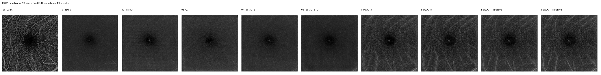
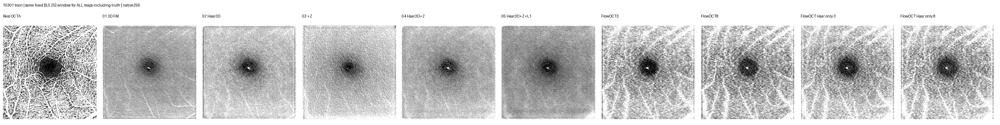
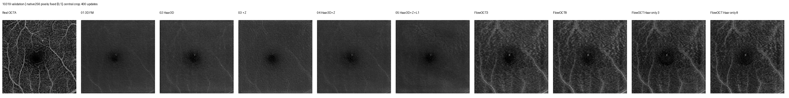
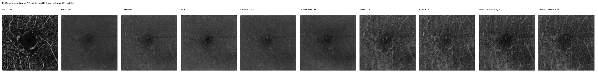
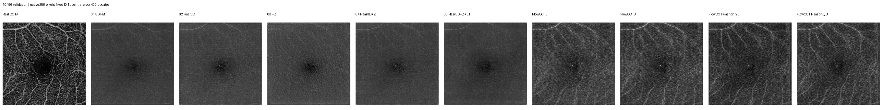
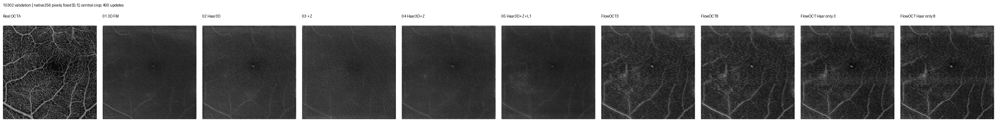

# 256³ 同病例试跑结果

训练病例10301，四位验证患者；各方法从头训练 400 次成功更新。
中央256³直接裁剪，未做横向缩放；仍不等于完整304×304视野。所有结果从纯OCT生成。
原五组保留模型和损失，使用块级及积分步重算；FlowOCT保留原生64张抽片，全局损失不拆，网络分8片重算。
新增07/08分别为无小波/二维Haar，仅保留作者ROI速度MSE；去掉重建、对比、投影监督和对比头。07网络分2片重算，08分8片，每次更新仍监督64片。
同更新数下，256³每次看到的体素与计算量比旧小块更多，不能把收益单独解释为上下文。
主图统一[0,1]；shared_lowwindow图统一[0,0.25]，含真值在内所有方法用同一个显示窗，评分与预测数值不变。

| 方法 | 训练 PCC | 训练 SSIM | 验证 PCC | 验证 SSIM |
|---|---:|---:|---:|---:|
| 01 3D FM | 0.3732 | 0.1494 | 0.3455 | 0.1593 |
| 02 Haar3D | 0.3937 | 0.1623 | 0.3821 | 0.1827 |
| 03 +Z | 0.3482 | 0.1498 | 0.3111 | 0.1599 |
| 04 Haar3D+Z | 0.3885 | 0.1540 | 0.3423 | 0.1639 |
| 05 Haar3D+Z+L1 | 0.3924 | 0.1453 | 0.3212 | 0.1481 |
| FlowOCT3 | 0.4679 | 0.2393 | 0.4361 | 0.2497 |
| FlowOCT8 | 0.4694 | 0.2528 | 0.4347 | 0.2574 |
| FlowOCT Haar only 3 | 0.4891 | 0.2465 | 0.4489 | 0.2722 |
| FlowOCT Haar only 8 | 0.4869 | 0.2556 | 0.4430 | 0.2703 |

不同视野的PCC/SSIM不宜直接比较；matched_roi64.json另列相同物理64×64区域的前后指标。
单病例、单种子、短程诊断；不能代表完整训练后的泛化性能。

## 相同训练位置64×64区域对照

新旧均为400次更新，目标区域逐元素一致。旧模型输入64块，新模型输入包含该区域的256块；同更新数下体素曝光与计算量不同。

| 方法 | 旧64 PCC | 新256 PCC | 旧64 SSIM | 新256 SSIM |
|---|---:|---:|---:|---:|
| 01 3D FM | 0.2512 | 0.1674 | 0.1568 | 0.1379 |
| 02 Haar3D | 0.2909 | 0.2374 | 0.1785 | 0.1555 |
| 03 +Z | 0.2683 | 0.2345 | 0.1493 | 0.1600 |
| 04 Haar3D+Z | 0.2649 | 0.2246 | 0.1675 | 0.1503 |
| 05 Haar3D+Z+L1 | 0.2886 | 0.2542 | 0.1648 | 0.1484 |
| FlowOCT3 | 0.4782 | 0.3203 | 0.3666 | 0.2611 |
| FlowOCT8 | 0.4747 | 0.3202 | 0.3778 | 0.2734 |

