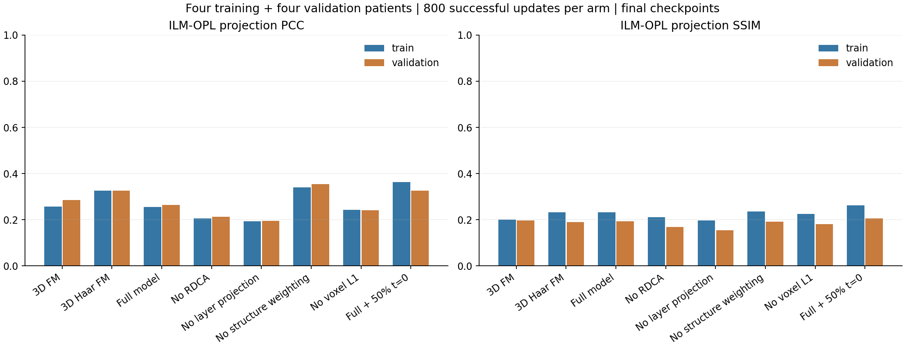
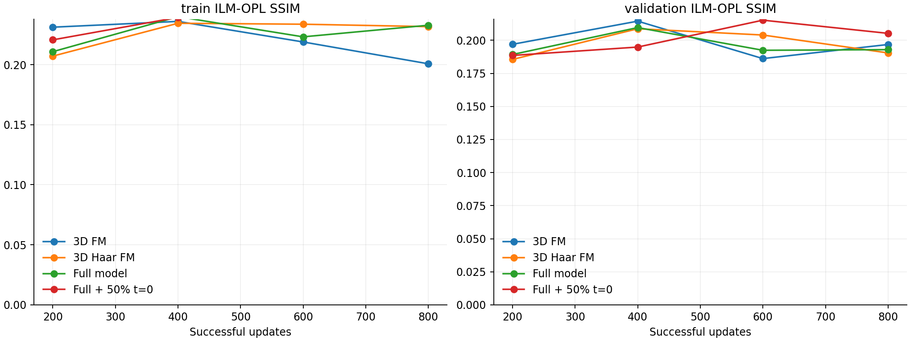
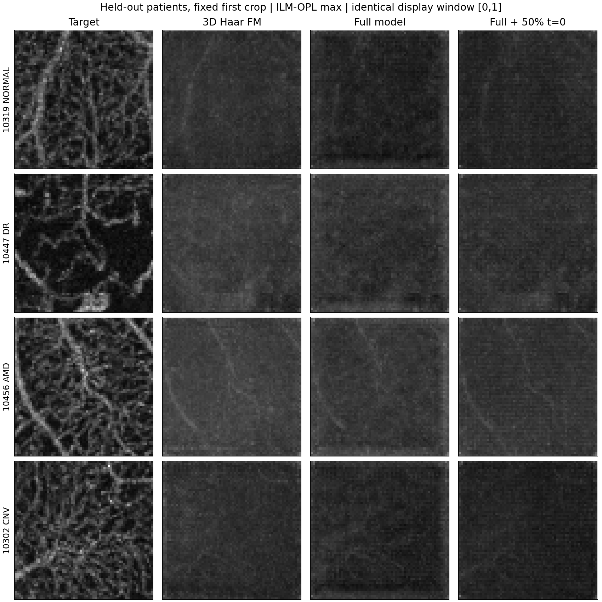
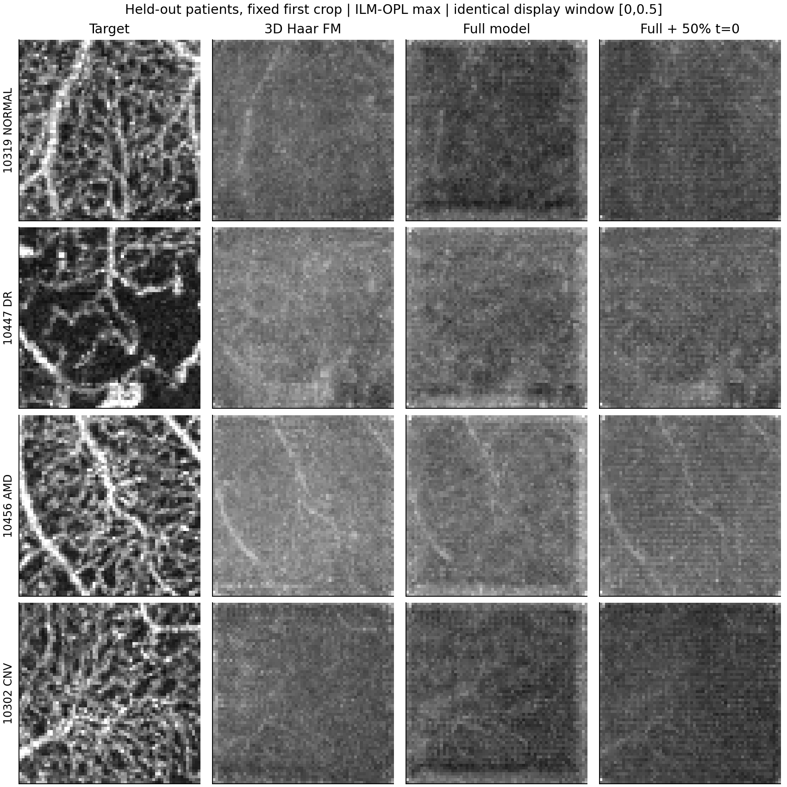

# 3D 小波 FlowOCT 完整模块：小样本验证报告

日期：2026-10-22。共 12 个独立运行、8,000 次成功优化更新，使用同一已冻结数据协议。

这是短程可行性和模块对照实验；单随机种子、训练/验证各四位患者，每例两个固定全 Z 体块。单病例阶段为 400 次更新；四病例阶段为 800 次更新。未读取测试病例图像，也未进行全数据 200 轮训练。

**所有表格使用仅从 OCT 自由积分的最终同预算检查点。路径中含真值的训练辅助终点没有用于生成指标。**

## 四病例实验

| 方法 | 训练 PCC | 训练 SSIM | 验证 PCC | 验证 SSIM | 验证体素 PSNR |
|---|---:|---:|---:|---:|---:|
| 体素 3D FM | 0.2563 | 0.2007 | 0.2854 | 0.1968 | 27.170 |
| 3D 小波 FM | 0.3259 | 0.2317 | 0.3256 | 0.1904 | 26.162 |
| 完整模型 | 0.2544 | 0.2328 | 0.2632 | 0.1929 | 25.043 |
| 去除 RDCA | 0.2059 | 0.2112 | 0.2135 | 0.1693 | 26.652 |
| 去除分层投影 | 0.1925 | 0.1972 | 0.1943 | 0.1541 | 25.383 |
| 去除结构加权 | 0.3399 | 0.2352 | 0.3540 | 0.1924 | 26.030 |
| 去除体素重建 | 0.2430 | 0.2257 | 0.2404 | 0.1806 | 25.832 |
| 完整模型＋50% 起点 | 0.3638 | 0.2615 | 0.3254 | 0.2052 | 27.701 |

PCC 和 SSIM 均为 ILM–OPL 最大投影指标；先在患者内平均两个体块，再对患者等权平均。

## 完整模块的增量与边界

完整模型相对小波 FM：验证 PCC 变化 **-0.0623**，SSIM 变化 **+0.0025**。

**本次结果不支持“把模块全部叠加后就优于小波基线”。** 完整模型的 SSIM 略有变化，PCC 和体素 PSNR 反而下降。统一显示窗下，预测仍偏模糊，未重建出真值中的清晰血管网络。

去除结构加权的验证 PCC 为 0.3540，完整模型为 0.2632；这提示当前阈值、背景权重和频域权重组合需要进一步受控验证，不能直接解释为论文中的结构聚焦模块普遍无效。

50% 起点组的验证 SSIM 为 0.2052、PCC 为 0.3254、体素 PSNR 为 27.701 dB。相对完整均匀时间组有所改善，但视觉细节仍不足，不能宣称起点问题已经解决。

去模块组只改变对应损失开关；同一表示的初始化、病例顺序、随机时间、优化器和更新预算均一致。完整模型与去投影组使用的额外训练标注不同：分层投影需要训练病例层标注。体素与小波组在网络输入通道及有效空间网格上不同，不能宣称参数逐个一致。

完整模型的标准组仍使用均匀时间。50% 起点组属于前期起点问题诊断的扩展，单列，不能当作 FlowOCT 原有贡献。

## 单病例拟合

| 方法 | 训练 PCC | 训练 SSIM | 验证 PCC | 验证 SSIM |
|---|---:|---:|---:|---:|
| 体素 3D FM | 0.2546 | 0.1599 | 0.3276 | 0.2014 |
| 3D 小波 FM | 0.2912 | 0.1787 | 0.3339 | 0.1861 |
| 完整模型 | 0.3464 | 0.2122 | 0.3203 | 0.1941 |
| 完整模型＋50% 起点 | 0.3482 | 0.2040 | 0.3369 | 0.1936 |

## 起点检查

下表直接检查同一训练数据上的速度 MSE。t=0.5 的状态含真值，只用于机制诊断，不是可部署输入。

| 方法 | 训练 t=0 MSE | 训练 t=0.5 MSE | 起点/中间误差比 |
|---|---:|---:|---:|
| 体素 3D FM | 0.00230753 | 0.00064818 | 3.56 |
| 3D 小波 FM | 0.00281423 | 0.00144050 | 1.95 |
| 完整模型 | 0.00296373 | 0.00153667 | 1.93 |
| 完整模型＋50% 起点 | 0.00227824 | 0.00188124 | 1.21 |

## 固定病例与固定显示窗

下图涵盖全部四位验证患者的第一体块，不按模型分数挑样例。

逐例 B-scan、均值/分层投影、误差和原始预测位于每组 `predictions/`。显示窗只影响图片，不改变指标。预测保留 Z256、64×64 体块网格，不声称恢复原始 Z640。

## 可复核性与文件

- `../verification/results_audit.json`：独立重算指标、输入/权重/输出 SHA256、更新数和对比头变化。
- `summary.csv`：全部逐组汇总；各运行 `final_metrics.json` 包含逐病例和逐患者数据。
- `../data/selection.json`：冻结病例、坐标、原输入指纹与标注用途。
- `../source/`：实际训练源码快照；`../run.py --resume` 使用该快照恢复。
- `latest.pt` 是固定终点主比较；`best_validation.pt` 仅根据验证集选择。

当前样本量和预算不能给出稳定的方法排名、统计显著性、全数据泛化或临床有效性结论。完整模块的实现选择（背景权重、频域 mask、层范围及辅助终点）见工程 README。

独立复核通过：8,000 次成功更新，164 份体块预测，重算主要指标与保存值一致。

12 项核心及端到端测试通过，记录见 `../verification/unit_tests.txt`。

另外完成 10319 的完整 256×304×304 验证体推理，见 `../verification/full_volume_smoke.json`。这是一例额外的整卷流程验证，不并入体块对照表。
