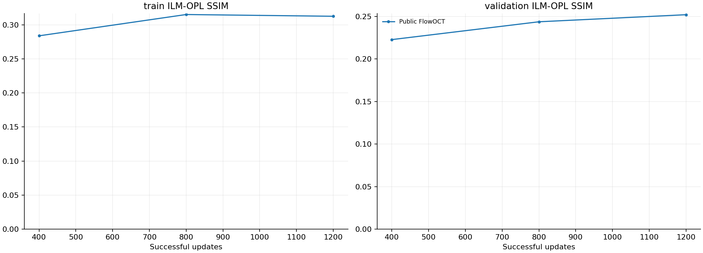

# 原版 FlowOCT 与三维模块累计删减：对照报告

日期：2026-10-22。计划 8 组，每组 2,400 次成功更新；当前完成 0 组。

固定 4 位训练患者、4 位验证患者，每例两个全 Z 体块，输入与前轮逐元素一致。所有主表都是纯 OCT 起步、Euler8、仅最终裁剪后的患者宏平均指标。测试集图像不参与本实验。

## 比较设置

| 组 | 小波 | 对比 | 投影 | 结构加权 | 重建 |
|---|---|---|---|---|---|
| 公开代码 FlowOCT | 二维 | 原切片InfoNCE | 原抽片max | 原ROI裁框 | L1 |
| 完整三维模型 | haar3d | 有 | 有 | 有 | 有 |
| 累计去对比 | haar3d | 无 | 有 | 有 | 有 |
| 再去投影 | haar3d | 无 | 无 | 有 | 有 |
| 再去结构加权 | haar3d | 无 | 无 | 无 | 有 |
| 再去重建：小波 FM | haar3d | 无 | 无 | 无 | 无 |
| 再去小波：体素 FM | voxel | 无 | 无 | 无 | 无 |
| 完整三维＋50%起点 | haar3d | 有 | 有 | 有 | 有 |

三维组 01→06 每一步仅在前一步上移除一个模块。该路径说明特定剩余模块组合下的条件贡献，不能当成各模块独立主效应或排除交互。50% 起点组单列，完整模块保持一致，只改变训练时间采样。

公开代码 FlowOCT 保留作者二维 MONAI 网络、二维 Haar、Adam(beta1=0.5)、FP32、无梯度裁剪及 10/0.5/0.005/0.1 权重。三维组保留原 AdamW、AMP、clip1 和 1/0.5/0.1/0.005 权重。因此原版与三维组是同数据、同更新数的方法对照；逐项因果解释只用于三维累计删减路径。

公开代码每次抽 16 张 B-scan，每张单独采样时间；三维组使用完整 256×64×64 体块和每块一个时间。每次体素曝光和计算量不同，不能说是等 FLOPs 或仅改变网络维度。公开代码中切片对比/投影也不等同于论文描述的物理轴向 RDCA/分层投影。

3D 第一段 800 次复用前轮的精确病例顺序和时间序列；后两段在训练前冻结。每个训练体块最终恰好曝光 300 次。全部组从头训练；主表取固定终点，不用验证集挑选对自己有利的预算。

## 同预算 800 次

| 方法 | 训练PCC | 训练SSIM | 验证PCC | 验证SSIM | 验证体素PSNR |
|---|---:|---:|---:|---:|---:|
| 公开代码 FlowOCT | 0.3943 | 0.3152 | 0.3702 | 0.2438 | 26.787 |
| 完整三维模型 | 待完成 | — | — | — | — |
| 累计去对比 | 待完成 | — | — | — | — |
| 再去投影 | 待完成 | — | — | — | — |
| 再去结构加权 | 待完成 | — | — | — | — |
| 再去重建：小波 FM | 待完成 | — | — | — | — |
| 再去小波：体素 FM | 待完成 | — | — | — | — |
| 完整三维＋50%起点 | 待完成 | — | — | — | — |

## 同预算 1,600 次

| 方法 | 训练PCC | 训练SSIM | 验证PCC | 验证SSIM | 验证体素PSNR |
|---|---:|---:|---:|---:|---:|
| 公开代码 FlowOCT | 待完成 | — | — | — | — |
| 完整三维模型 | 待完成 | — | — | — | — |
| 累计去对比 | 待完成 | — | — | — | — |
| 再去投影 | 待完成 | — | — | — | — |
| 再去结构加权 | 待完成 | — | — | — | — |
| 再去重建：小波 FM | 待完成 | — | — | — | — |
| 再去小波：体素 FM | 待完成 | — | — | — | — |
| 完整三维＋50%起点 | 待完成 | — | — | — | — |

## 同预算 2,400 次

| 方法 | 训练PCC | 训练SSIM | 验证PCC | 验证SSIM | 验证体素PSNR |
|---|---:|---:|---:|---:|---:|
| 公开代码 FlowOCT | 待完成 | — | — | — | — |
| 完整三维模型 | 待完成 | — | — | — | — |
| 累计去对比 | 待完成 | — | — | — | — |
| 再去投影 | 待完成 | — | — | — | — |
| 再去结构加权 | 待完成 | — | — | — | — |
| 再去重建：小波 FM | 待完成 | — | — | — | — |
| 再去小波：体素 FM | 待完成 | — | — | — | — |
| 完整三维＋50%起点 | 待完成 | — | — | — | — |

## 为什么此前生成效果差

前一轮的“完整模型”是三维研究扩展，包含自定结构权重、层范围和辅助终点实现；并非作者原代码。新实验把公开代码 FlowOCT 单独加入，避免把三维扩展的结果当成作者方法的结果。

**最直接的现象是：含真值的训练状态估计明显好于纯 OCT 生成，连训练块的血管映射也未充分学好。**

以下使用上轮 800 次完整三维模型，每位训练患者固定第一块；不是新模型的测试成绩。

| 训练病例 | 含50%真值的状态估计 PCC | 纯OCT起点单步 PCC | 纯OCT八步生成 PCC |
|---|---:|---:|---:|
| 10301 | 0.9380 | 0.2068 | 0.1822 |
| 10304 | 0.9568 | 0.3017 | 0.2761 |
| 10310 | 0.9395 | 0.1099 | 0.1105 |
| 10439 | 0.9333 | 0.2510 | 0.1895 |

三维网络同时接收固定 OCT c 和插值状态 x_t=(1−t)c+t*y。对于 t>0，代数上存在 y−c=(x_t−c)/t 的通道，而 t=0 时必须真正学会由 OCT 推断 OCTA。这说明一个可能的捷径；当前证据没有证明网络内部精确实现了该公式，也不证明流匹配理论本身无效。

**损失组合也有需要排查的局部失衡和冲突。** 下表的梯度已乘实际损失权重，均只对生成主干计算。使用 t=0 探针；它反映起点处的局部行为，不代表所有训练时间的平均。

| 病例 | FM梯度范数 | 重建梯度范数 | 投影梯度范数 | 对比梯度范数 | FM与投影梯度余弦 |
|---|---:|---:|---:|---:|---:|
| 10301 | 0.5731 | 0.9595 | 0.3743 | 2.3563 | 0.9046 |
| 10304 | 0.2597 | 0.5122 | 0.4362 | 0.9638 | -0.7689 |
| 10310 | 1.0887 | 1.3817 | 0.4211 | 0.6992 | -0.9063 |
| 10439 | 0.3683 | 0.8188 | 0.1894 | 2.8104 | -0.2975 |

负余弦表示该点上两项梯度方向相反；较大的对比梯度会影响共同更新。这不能单独证明某模块导致失败，因此还需要下面的真实训练删减对照。也不能用标量 loss 的大小直接代替梯度影响。

预算短是限制之一，但不是唯一解释：此前相同三维主干的纯起点监督可记住单个训练块，普通随机时间 FM 延长到 7,200 次后仍未得到相同拟合效果。该证据来自单块实验，不能直接外推四病例泛化。本轮把所有方法统一延长到 2,400 次，并保留中间节点，检验短程排序是否持续。

目标图在相同 Z256 网格仍有清晰血管；固定窗、轴序和保存目标的核验也通过。当前证据不支持仅把失败归因于显示窗、积分步数或完全没有网络容量。小体块上下文、有限病例数及目标本身的不确定性仍可能影响泛化，本轮没有逐一证明它们的贡献。

## 固定病例的图像对比

每张图使用全部四位患者的固定第一体块，所有面板共用显示窗 [0,0.5]。不按模型分数挑病例。
## 结论边界与文件

这是固定小样本、单种子的机制对照。训练高分说明拟合，不等于新患者泛化。不能把任何一条累计路径、一个预算节点或一组局部梯度，单独视为最终方法排名或医学有效性证明。

- `summary.csv` 保存全部同预算患者宏平均结果；各组 `metrics_*.json` 包含逐病例和逐患者数据。
- 各组 `update_00800.pt`、`update_01600.pt`、`update_02400.pt` 保存模型、优化器和 AMP 状态。
- `predictions_*/` 保存原始预测及目标、固定窗 B-scan 和分层投影；原版另存 `predictions_native3/`。
- `../verification/diagnosis_prior800.json` 和 `diagnosis_final.json` 保存辅助终点、自由生成与梯度诊断。
- `../verification/results_audit.json` 保存源码、输入、输出哈希、成功更新、优化器计数和指标独立重算。
