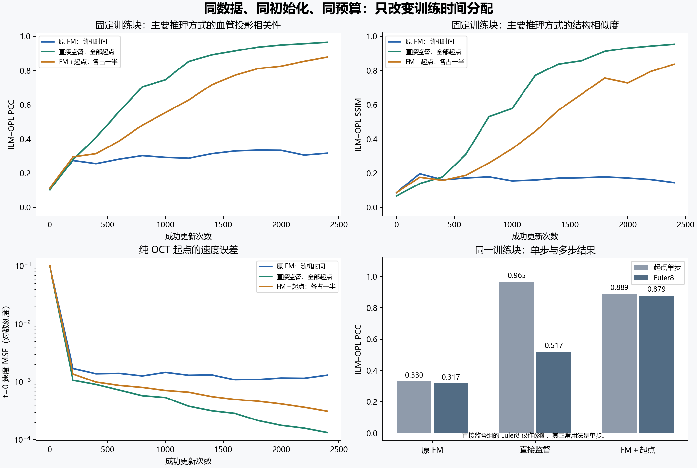
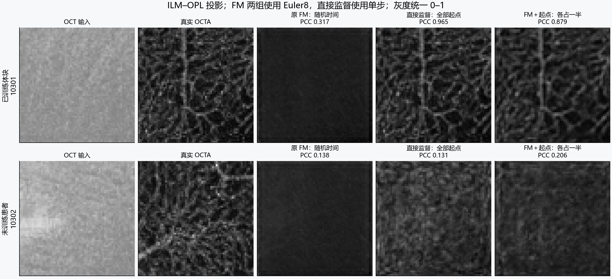

# 原 FM、直接监督、FM＋起点监督：严格匹配的单块对照

完成时间：2026-10-22T10:34:19.774255+08:00。服务器物理GPU0。共 **7200次成功优化更新**，每组2400次。

## 这轮回答什么

上一轮第3列是原来的多病例FM权重，第6列是反复训练一个体块的监督权重，训练曝光次数不一致，不能据此把差异单独归因于FM目标。本轮把网络、初始化、体块、优化器、更新数和每步网络调用数全部固定，只改变时间采样。

本轮三组均从同一随机初始化重新训练2400次；“原FM”表示原来的随机时间训练方式。

在这一固定训练块与种子下，增加起点时间采样使真正的8步自由生成有所改善：ILM–OPL PCC 比原 FM 高 0.5618，SSIM 高 0.6915。 按协议预先记录的全Z最大投影阈值（PCC≥0.90、SSIM≥0.80），混合组仍未同时通过，不能称为已经修复。

保留的两位验证患者上，混合组相对原 FM 的 ILM–OPL PCC 差值为 +0.0319、SSIM 差值为 +0.0454。两位患者不足以支持稳定泛化结论。

## 三组到底改变了什么

共同路径：`x_t=(1−t)·OCT+t·OCTA`，速度目标 `OCTA−OCT`，损失均为全体素MSE。

| 组别 | 2400次训练更新的时间分配 | 正常推理方式 |
|---|---|---|
| 原FM | 全部均匀随机t | 从纯OCT开始，Euler8 |
| 直接监督 | 全部t=0 | 一次修正，OCT＋v(OCT,0,OCT) |
| FM＋起点 | 1200次t=0，1200次随机t，交替进行 | 从纯OCT开始，Euler8 |

第三组通过混合时间采样实现额外起点监督，不是每次更新多算一个损失分支。它对应等权的“起点MSE与均匀时间FM MSE”混合目标；每次更新仍只有一次前向和反向。随机部分复用原FM在对应更新编号上的相同时间。它同时减少了随机中间时刻的更新数，结果应解释为这种时间预算分配的影响。

直接监督组的速度MSE与最终OCTA MSE在t=0代数等价；实际模型上的数值与梯度检查通过，见 `preflight.json`。

由于三组时间分布不同，不用平均训练loss给三组排名；统一检查只含OCT的生成结果与固定时间速度误差。

## 固定条件

- 原始3D主干，base16，**2,097,521参数**，完全相同的初始状态哈希 `39ed864e077193dddd4ef16dfaa3fc0ed0cc6e5d03e2736143eaeb111d37d1ba`。
- 训练仅用10301的 `[256,64,64]` 体块，起点 `[0,64,64]`，三组输入文件哈希相同，无增强、换块或额外标签损失。
- AdamW，lr2e-4，weight_decay0，clip1；FP16 AMP、FP32损失与评价；每组2400次成功更新。
- 直接比较固定最终权重，未根据验证分数挑选检查点；每200次更新记录训练块曲线。
- 无小波、投影损失、分割或其他附加目标；真实层边界只在推理后计算ILM–OPL投影。
- 单个随机种子。额外评价保留上一轮固定8块，未使用测试患者。原训练集中的10303对这些诊断模型同样是未训练患者。

## 最终训练块结果

以下每组均使用表中列出的正常推理方式：原FM与混合组Euler8，直接监督组单步。

| 组别 | 起点更新数 | 体积MAE↓ | ILM–OPL PCC↑ | ILM–OPL SSIM↑ |
|---|---:|---:|---:|---:|
| 原 FM：随机时间 | 0 | 0.021858 | 0.3167 | 0.1454 |
| 直接监督：全部起点 | 2400 | 0.005002 | 0.9655 | 0.9537 |
| FM＋起点：各占一半 | 1200 | 0.008927 | 0.8785 | 0.8369 |

直接监督训练块 PCC 为 **0.9655**、SSIM为 **0.9537**。这是单步拟合能力正对照，不能把它的权重当作已训练好的多步速度场。

## 相同推理步数的补充对照

同一个已训练块的ILM–OPL PCC：

| 组别 | 起点单步 | Euler8 | Euler32 |
|---|---:|---:|---:|
| 原 FM：随机时间 | 0.3297 | 0.3167 | 0.3104 |
| 直接监督：全部起点 | 0.9655 | 0.5169 | 0.4622 |
| FM＋起点：各占一半 | 0.8891 | 0.8785 | 0.8689 |

直接监督组在训练时没有接触t>0，它的多步结果只用于诊断时间外推，不能据此判断其正常单步方法失败。混合组是否有效，主要看真正从OCT开始的Euler8输出；起点单步变好但Euler8没变好，不能称为FM生成能力恢复。

## 未训练患者结果

10302与10319，每例两个固定体块；先按患者平均体块，再对两位患者等权平均。

| 组别 | 体积MAE↓ | ILM–OPL PCC↑ | ILM–OPL SSIM↑ |
|---|---:|---:|---:|
| 原 FM：随机时间 | 0.027420 | 0.2966 | 0.1947 |
| 直接监督：全部起点 | 0.021343 | 0.2411 | 0.1594 |
| FM＋起点：各占一半 | 0.019610 | 0.3285 | 0.2401 |

此外还保存了同一训练患者另一个体块以及10303两块的结果，见 `per_patch.csv`。同患者两块边缘有少量空间重叠，不应当作独立患者。

这仍是一轮单块机制诊断。训练块拟合改善不等于学习了新患者的血管映射，不能用两位验证患者给方法作正式排名，也不能据单个种子给出显著性结论。

## 可以据此采取的下一步

本轮受控干预支持“起点时间覆盖是一个可改善因素”：保持其他条件一致，把一半更新分给t=0，真正从OCT开始的多步生成结构随之改善。这不证明网络严格利用了某个代数捷径，也不说明所有失败都来自起点。

直接监督仍然是训练块拟合最好的正对照；混合组的意义在于它保留了其他时间的训练，同时让8步生成接近其起点单步效果。两位未训练患者的改善有限，建议下一轮固定4个训练病例，保持这三组及相同预算设置，检验多病例下的新患者图像和指标是否同步改善。50%是本次诊断比例，不是已经选出的最优超参数。

## 一致性复核

- 三组实际初始参数逐字节一致，训练数据和成功更新次数一致。
- 逐条核对7200条训练记录与冻结时间序列；起点更新数分别为0、2400、1200。
- 各组AMP跳过次数：fm_uniform=0, direct_t0=0, fm_half_start=0。若有跳过，不推进预设时间序列，仍以成功更新计数。
- 核对24份三维预测的形状、有限性、真值逐元素一致性和重新计算的体积MSE。
- 独立脚本重新从保存的三维预测计算ILM–OPL投影、PCC和SSIM，与指标和图片逐项吻合；三组初始单步输出一致。
- 模型与评价依赖源码哈希未变；未使用测试患者。

所有训练在物理GPU0完成；运行耗时受服务器资源状态影响，不作为吞吐率比较。

## 复核文件

服务器总目录：`/srv/oct_research/fm_start_control_20261022`。

冻结初始权重、时间序列、输入体块、训练记录、800/1600/2400步检查点与三维预测均保留服务器。本地保存小型指标、图像和报告。协议与审计见 `protocol.json`、`preflight.json`、`final_audit.json`，逐块表见 `per_patch.csv`，完整汇总见 `summary.json`。
