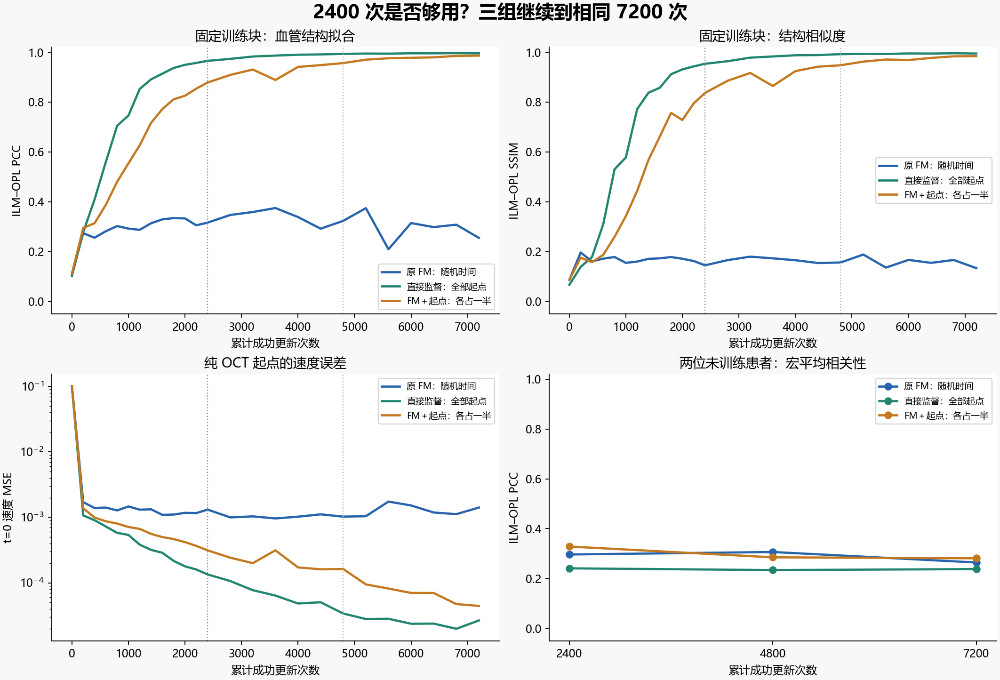
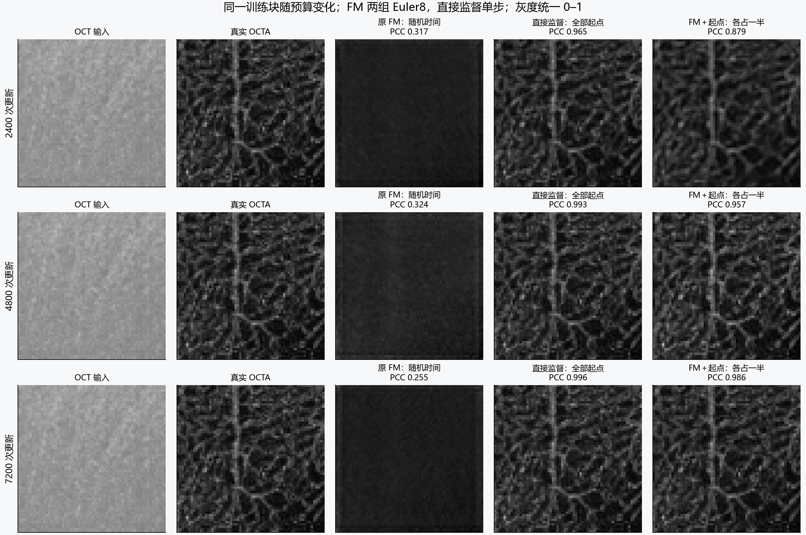

# 从2400继续到7200次：训练预算验证

全部训练完成：2026-10-22T11:41:15.972814+08:00。三组均从各自2400次断点恢复，最终均达到7200次成功更新。新增14400次，含原实验累计21600次。

## 怎样回答“2400次够不够”

2400次只能回答那个预算下的比较，不能证明原FM在更长训练后也学不好。本轮把三组都延长到相同的4800与7200次，保留完整曲线和固定预算结果，检查慢收敛、持续改善与训练/新患者差距。

原FM的训练块PCC从 0.3167 变为 0.2554（-0.0613）；混合组相对原FM的PCC差值从 0.5618 变为 0.7310。

本轮的直接回答是：**2400次对混合组尚不足以充分记住训练块，延长确实有收益；但在当前随机时间与固定学习率设置下，原FM增加到7200次仍没有持续恢复血管结构，因此不能仅用“训练次数少”解释它的失败。** 原FM后段有明显波动，不应把某个末轮分数单独当作训练更久必然更差的证据。

新患者PCC的2400→7200变化为：原 FM：随机时间从 0.2966 到 0.2645；直接监督：全部起点从 0.2411 到 0.2381；FM＋起点：各占一半从 0.3285 到 0.2814。这两位患者上，更多更新没有带来泛化改善。训练块记忆更充分和新患者有效是不同问题。

沿用上一轮预先写下的**全Z最大投影PCC≥0.90且SSIM≥0.80**这一单块记忆参考标准，原 FM：随机时间：三个节点均未通过；直接监督：全部起点：在2400、4800、7200次节点通过；FM＋起点：各占一半：在4800、7200次节点通过。该阈值用于记忆诊断，不代表新患者泛化。

这些是固定体块、单种子的观察，不是收敛极限或全数据性能排名。7200次同样是有限预算，不能据此断言再训练永远不会改善。

## 固定预算的结果

全部为ILM–OPL最大投影指标；原FM与混合组使用纯OCT起步Euler8，直接监督组使用正常的单步预测。两位未训练患者（10302、10319），各两块，先平均患者内体块再等权平均患者。

| 累计更新数 | 训练方式 | 训练PCC↑ | 训练SSIM↑ | 未训练患者PCC↑ | 未训练患者SSIM↑ |
|---|---|---:|---:|---:|---:|
| 2400 | 原 FM：随机时间 | 0.3167 | 0.1454 | 0.2966 | 0.1947 |
| 2400 | 直接监督：全部起点 | 0.9655 | 0.9537 | 0.2411 | 0.1594 |
| 2400 | FM＋起点：各占一半 | 0.8785 | 0.8369 | 0.3285 | 0.2401 |
| 4800 | 原 FM：随机时间 | 0.3238 | 0.1568 | 0.3066 | 0.2061 |
| 4800 | 直接监督：全部起点 | 0.9935 | 0.9923 | 0.2341 | 0.1489 |
| 4800 | FM＋起点：各占一半 | 0.9565 | 0.9478 | 0.2853 | 0.2071 |
| 7200 | 原 FM：随机时间 | 0.2554 | 0.1342 | 0.2645 | 0.1886 |
| 7200 | 直接监督：全部起点 | 0.9957 | 0.9948 | 0.2381 | 0.1435 |
| 7200 | FM＋起点：各占一半 | 0.9864 | 0.9843 | 0.2814 | 0.2037 |

## 原FM在学什么：起点与中间状态的速度误差

同一个训练块，直接比较速度MSE，不经过ODE：

| 累计更新数 | 训练方式 | t=0速度MSE | t=0.5速度MSE | 起点/中间误差比 |
|---|---|---:|---:|---:|
| 2400 | 原 FM：随机时间 | 0.00131516 | 0.00017382 | 7.57 |
| 2400 | FM＋起点：各占一半 | 0.00031352 | 0.00007028 | 4.46 |
| 4800 | 原 FM：随机时间 | 0.00102650 | 0.00012772 | 8.04 |
| 4800 | FM＋起点：各占一半 | 0.00016246 | 0.00004181 | 3.89 |
| 7200 | 原 FM：随机时间 | 0.00141260 | 0.00003945 | 35.80 |
| 7200 | FM＋起点：各占一半 | 0.00004447 | 0.00001871 | 2.38 |

t=0.5输入含有真实OCTA，不能当作有效生成输入；其误差下降与纯OCT起步的生成改善需要分开判断。直接监督组未训练t>0，因此不以它的中间状态误差判断正常单步方法。

原FM从2400到7200次，t=0.5速度MSE下降约 77.3%，而t=0误差变化为 +7.4%。这支持“中间路径拟合改善没有转化为起点能力”的解释，但没有证明网络内部精确使用了哪一种捷径。

## 控制条件与恢复检查

- 共同起始模型和同一训练体块沿用原实验；原2400次目录未改写。
- 从2400次模型、AdamW动量/二阶矩、AMP scaler继续训练；核对所有参数的优化器计数为2400，而不是重建优化器重新开始。
- 学习率始终2e-4、weight_decay0、clip1；原FM随机t、直接监督全t=0、混合组恰好50%t=0。
- 重新生成7200项时间序列，并验证前2400项与原序列逐元素一致；后续序列在训练前冻结。
- 每组先到4800，再全部到7200；采用固定最终节点，不根据验证集挑选检查点或调整学习率。
- 每段恢复后，先比较原断点的生成指标，要求误差小于1e-6；全部通过。每400次记录训练块曲线。
- 无小波、新损失或额外标签监督。真实层边界只用于推理后的投影评价。

审计逐条核对新增14400次成功更新、时间序列和优化器计数，并检查48份新增三维预测。独立复核见 `verification.json`。

## 解释边界

训练块变好说明记忆/拟合能力改善。新患者结果仍然需要单独看；单块反复训练不能检验覆盖多种病变的泛化能力。训练高分不能替代新患者评价。

下一轮更有信息量的方向是扩到固定4个训练病例，继续保留原FM、直接监督、混合组的同预算对照；检验起点监督能否帮助多个输入学习共同映射。50%起点比例是本次诊断设置，不是已选出的最佳超参数。

“原FM”指原来的随机时间训练方式，它在本次对照中与另两组使用相同样本和预算；不是原多病例训练的200轮权重。

## 文件与存储

服务器：`/srv/oct_research/fm_start_long_20261022`。原2400次结果：`/srv/oct_research/fm_start_control_20261022`。

新结果分别在 `stage_4800/`、`stage_7200/` 的三组子目录中。模型、优化器、三维预测保留服务器。本地保存小型指标、图像和报告；原始表格见 `budget_comparison.csv`，完整数值见 `summary.json`，恢复与冻结协议见 `protocol.json`。
