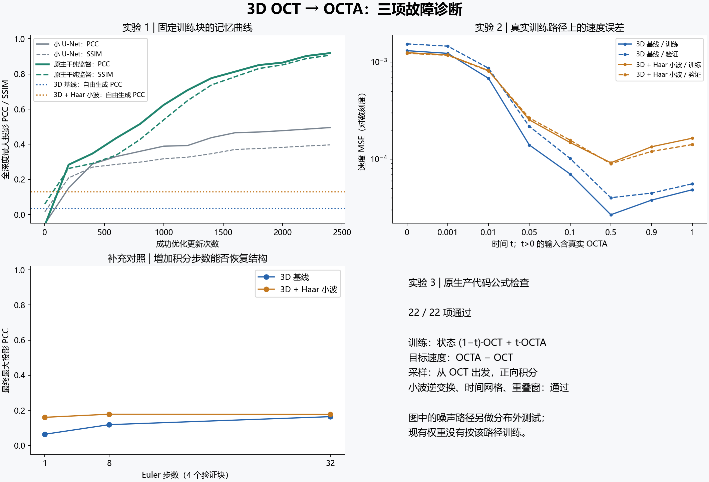
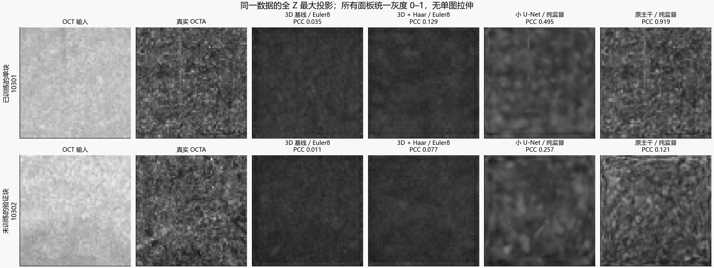
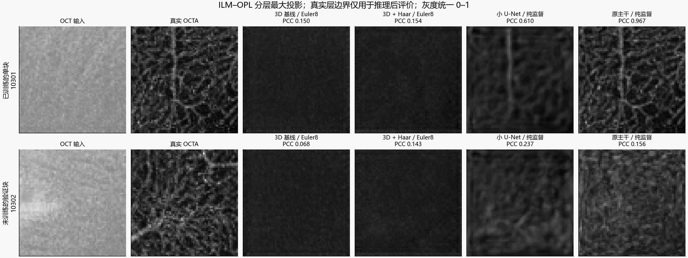

# 3D 基线与 3D 小波：三项服务器诊断

运行在服务器物理 GPU0，原有 GPU1 训练持续运行。全部实验与最终复核完成时间：2026-10-21T22:07:13.210807+08:00。含三项诊断、同主干监督控制与推理后分层评价。

## 判断

与基线相同的 3D 主干在纯监督下通过了记忆阈值，而两组 FM 的纯 OCT 自由生成仍很差。当前证据最支持：原 FM 的起点映射没有学好，训练中间状态的低误差没有转化为从 OCT 出发的结构恢复。不能把失败笼统归因为“三维网络完全学不会”。

两组 FM 权重都应根据“纯 OCT 起点的速度误差”与“含真值插值状态的速度误差”的差异判断训练是否覆盖了实际生成需求。下表和图像是本次冻结快照的实测结果。公式检查全部通过，暂未发现训练/采样的符号、时间方向或小波接口错误。增加积分步数的实际收益见下表，不能仅因中间状态误差低就把失败归咎于 ODE。

## 冻结对象与数据

- 3D 基线：第 **106** 轮，SHA256 `ba73fe2e8aadda4130c2e8ac67d52e0aa565b3f57f67ba804ffa8d7978a449da`。
- 3D 小波：第 **195** 轮，SHA256 `b1cb22db701c5a6704417bf96990118d4520417e9a468312a551028fdc1fd342`。
- 固定选训练病例 10301、10303，验证病例 10302、10319；每例取 `[Z,Y,X]=[256,64,64]`、起点 `(0,64,64)` 与 `(0,120,120)` 两块。共 4 位患者、8 块，无测试病例。
- 每位患者先平均两块，再按患者等权平均。样本少、单随机种子，用于机制诊断，不能作为方法排名或泛化性能证明。
- 投影指标均为**全深度 Z 最大投影**，不是 ILM–OPL 指标，也不是血管分割/拓扑精度。
- 现有两组实际训练起点是 OCT，**不是高斯噪声**。图中噪声路径的额外检查见实验 2 的分布外结果。

## 实验 1：纯监督单样本记忆

从头训练独立的小型 3D U-Net：base16、两次降采样，353,921 参数；只输入 OCT，直接预测 OCTA；无时间条件、无 FM、无小波、无投影或分割损失。只训练 10301 的 `(0,64,64)` 固定块，纯全体素 MSE，2400 次成功更新，FP32，Adam，无 weight decay。前 1600 次学习率 2e-4，后 800 次 5e-5。没有增强或换块。

训练块原始输出：MAE **0.213788 → 0.010508**，最大投影 PCC **-0.0534 → 0.4950**，SSIM **0.0152 → 0.3964**。最终 MSE 是该目标均值常数预测器的 **19.10%**。预先记录的记忆阈值为 PCC≥0.90、SSIM≥0.80、MSE≤常数预测器的10%；是否全部通过：**False**。

同一训练块的最终裁剪后比较：

| 模型 | 体积 MAE ↓ | 最大投影 PCC ↑ | 最大投影 SSIM ↑ |
|---|---:|---:|---:|
| 3D 基线，8 步自由生成 | 0.013293 | 0.0351 | 0.1720 |
| 3D + Haar 小波，8 步自由生成 | 0.013768 | 0.1292 | 0.1804 |
| 监督 U-Net，2400 次更新 | 0.009954 | 0.4950 | 0.3964 |
| 原主干纯监督，2400 次更新 | 0.005096 | 0.9190 | 0.9070 |

这是能力正对照，模型与训练目标不同，不能把差值归因为唯一的因素。新监督模型未在额外块上训练；其所有保留块结果见 `experiment1_supervised/result.json`。训练块拟合好不等于新患者泛化好。

### 补充：把主干容量固定的直接监督控制

小网络未达到全部阈值后，为避免把新换的网络结构/容量引入归因，补训了**与原基线完全相同的 2,097,521 参数主干**。仍从相同种子随机初始化，只输入固定训练块的 OCT，固定 t=0，以 `prediction=OCT+network(OCT,0,OCT)` 做直接回归，纯 MSE；不构造 FM 插值状态，也不做 ODE。AdamW、lr2e-4、weight_decay0、clip1、AMP，对齐原主干训练设置。2400 次成功更新，AMP 跳过 0 次，没有据验证集选轮。

其训练块 PCC **0.9190**、SSIM **0.9070**，MSE 是目标均值常数预测器的 **3.91%**；是否通过同一阈值：**True**。这是同一网络在直接监督下的拟合能力，**不是训练好的多步 FM 模型**。不能把其 t=0 回归权重直接拿去做多步采样，也不能把其训练分数当作验证泛化分数。

附加控制的动机、配置、完整曲线和所有保留块结果均单独记录在 `experiment1_same_backbone/`；没有替换或丢弃小网络的失败结果。它与 FM 的训练历史、训练样本覆盖和预算不同，是机制正对照，并非单因素方法性能消融。

### 推理后补充：血管层的投影视图

全 Z 最大投影会混入其他层信号，因此另对预先选定的第一位训练/验证患者各两块，使用已有官方 ILM–OPL 层边界做推理后评价。先核对了其 OCT 和 OCTA 与既有冻结数据逐元素完全一致，4 块均通过；层边界从未输入生成模型，也未参与本次监督训练。没有按结果挑图或调整阈值。

以下是 10301 与 10302 的 `(0,64,64)` 两块；它们是两个具体样例，不是全部验证患者的平均：

| 模型 | 训练 ILM–OPL PCC | 训练 SSIM | 验证 ILM–OPL PCC | 验证 SSIM |
|---|---:|---:|---:|---:|
| 3D 基线 / Euler8 | 0.1500 | 0.1233 | 0.0677 | 0.1120 |
| 3D + Haar / Euler8 | 0.1539 | 0.1192 | 0.1434 | 0.1079 |
| 小 U-Net / 纯 MSE | 0.6096 | 0.3999 | 0.2372 | 0.2165 |
| 原主干 / 纯 MSE | 0.9668 | 0.9540 | 0.1561 | 0.1542 |

这组图也显示必须区分训练块的记忆和新患者的生成。高训练 PCC/SSIM 是正对照通过的依据，不是恢复了泛化的证明。完整4块指标及精确数据一致性检查见 `posthoc_layers/result.json`。

## 实验 2：速度场是否学好

先严格使用生产训练路径 `x_t=(1−t)c+tY`、`u=Y−c`，其中 `c=OCT`。小波模型在线性 Haar 域计算同一条路径，再逆变换评价图像。所有探针 FP32，无 ODE 采样参与速度误差。时间取 0、0.001、0.01、0.05、0.1、0.5、0.9、1。

验证患者宏平均的速度 MSE：

| 模型 | t=0 | t=0.1 | t=0.5 | t=0.9 | t=0 / t=0.5 |
|---|---:|---:|---:|---:|---:|
| 3D 基线 | 0.00154394 | 0.00010183 | 0.00004003 | 0.00004470 | 38.6 倍 |
| 3D + Haar 小波 | 0.00123364 | 0.00015711 | 0.00008980 | 0.00012030 | 13.7 倍 |

`velocity_per_patch.csv` 保留每块数值；`summary.json` 同时给出相对于零速度预测的 RMSE、速度 PCC 和真实强度>0.1 区域的误差，避免仅看绝对 MSE。强度阈值不等于血管标注。

**所有 t>0 的真实路径输入已经含真实 OCTA；其终点图像不能当作有效生成。** 尤其 t 接近1时，输入本身已接近真值。起点 t=0 与纯 OCT 自由积分才检查实际生成能力。

当前路径加固定 OCT 条件，在 t>0 时满足 `Y−c=(x_t−c)/t`。这提供可利用的代数通道，说明低中间状态 loss 不足以保证学好了起点；本实验并不证明网络精确实现了该表达式，也不说明所有 FM 方法都存在同样失败。

### 积分步数与求解器对照

4 个验证块的自由生成最大投影 PCC：

| 模型 | Euler 1 | Euler 8 | Euler 32 |
|---|---:|---:|---:|
| 3D 基线 | 0.0641 | 0.1188 | 0.1642 |
| 3D + Haar 小波 | 0.1605 | 0.1783 | 0.1771 |

另外固定第一位验证患者 10302、`(0,64,64)` 单块，检查更密步数与二阶 Heun：

| 模型 | 求解器与步数 | MAE ↓ | 最大投影 PCC ↑ |
|---|---|---:|---:|
| 3D 基线 | euler 8 | 0.013028 | 0.0109 |
| 3D 基线 | euler 32 | 0.012779 | 0.0507 |
| 3D 基线 | euler 128 | 0.012884 | 0.0748 |
| 3D 基线 | heun 8 | 0.012971 | 0.0285 |
| 3D 基线 | heun 32 | 0.012847 | 0.0703 |
| 3D + Haar 小波 | euler 8 | 0.014248 | 0.0766 |
| 3D + Haar 小波 | euler 32 | 0.014460 | 0.0868 |
| 3D + Haar 小波 | euler 128 | 0.014699 | 0.0986 |
| 3D + Haar 小波 | heun 8 | 0.014227 | 0.0804 |
| 3D + Haar 小波 | heun 32 | 0.014659 | 0.0930 |

这部分是诊断采样敏感性，没有根据测试集选求解器。单块额外对照不代表4块的宏平均，也不代表整个体积的所有拼接设置。

### 图中随机噪声路径的补充检查

还使用三组固定随机种子的高斯噪声 ε，构造 `(1−t)ε+tY`，保持 OCT 条件不变，直接比较预测速度与 `Y−ε`。验证患者、每块先平均3种噪声后的相对 RMSE：

| 模型 | t=0.1 | t=0.5 | t=0.9 |
|---|---:|---:|---:|
| 3D 基线 | 1.221 | 1.197 | 1.104 |
| 3D + Haar 小波 | 1.330 | 1.296 | 1.125 |

**这些权重从未按高斯噪声起点训练，因此这是分布外压力测试，不能把其误差当作原训练的实现错误。** 若要比较噪声条件 FM 的可学习性，需要单独重训，不能直接更换现有模型的推理起点。

## 实验 3：训练与推理公式一致性

直接导入本次从服务器冻结的两份生产代码，共 **22 项检查全部通过**，而不是只对新写的公式做自证：

- 用记录器检查生产 `flow_loss` 在 t=0/0.1/0.5/0.9/1 的输入状态、固定条件与速度目标；提供精确速度后损失为零。
- 用解析已知的有正有负速度测试生产 `generate_volume`。覆盖 1/8/32 步、多个重叠窗、奇数尺寸、Haar padding、逆变换、裁回原尺寸与训练模式恢复；终点最大误差小于1e-5。
- 检查采样时间网格为 `0,1/N,...,(N−1)/N`，起点为 OCT，按正向步长积分；反转速度的负对照确实失败。
- Haar 正逆变换与体素/系数域 MSE 的数值一致性通过；图中噪声路径本身的终点代数恒等式也通过。

另外核对了两份生产训练循环：实际调用均以 `sample['oct']` 为 source、`sample['octa']` 为 target；小波循环将配置中的表示方式传给 `flow_loss`。未发现调用处把源和目标交换或重复变换。

因此目前没有证据支持“训练走 OCT→OCTA，推理却反向走”“漏了步长”“小波子带接口错位”等解释。这个结论覆盖上述路径和测试范围，不等于证明所有数据、所有边界或学习到的速度场都正确。

## 下一步

优先在同一固定块上做独立干预：保持主干和数据，加入明确的纯 OCT 起点监督，记录 t=0 速度误差以及真正从 OCT 起步的自由生成投影曲线。只有自由生成也随之恢复结构，再扩展多病例、投影损失与完整训练。噪声起点应作为需要重训的独立分支；本次不据其分布外表现否定或支持这条分支。

## 复核与存储

服务器完整目录：`/srv/oct_research/three_diagnostics_20261021`。包括冻结权重、生产源码、输入体块、监督模型检查点、日志和完整指标。原生产目录没有被本次实验修改。

本地保留协议、哈希、指标、投影数组与图像；大体积输入和模型保留服务器，见 `SERVER_RUN.md`。主要数据：`protocol.json`、`input_audit.json`、`summary.json`、`velocity_per_patch.csv`、各实验的 `result.json` 和 `final_audit.json`。基线仍在另一路续训，之后的 best 可能正常更新；本报告始终指冻结的第 106 轮。
